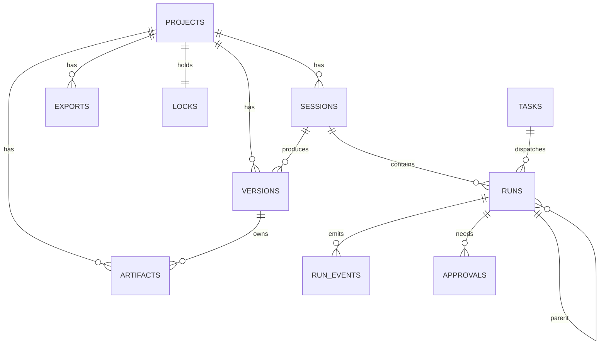

# 数据模型与存储

状态：**v1 设计基线**（2026-11-19）
权威类型：`packages/contracts`；本文说明**这些数据存在哪、表怎么建、为什么这么建**。

---

## 1. 存储分层

| 存储 | 存什么 | 为什么 |
|---|---|---|
| **D1** | 项目、会话、产物索引、导出记录 | 需要**跨项目**列表与查询；DO 无法全局查询 |
| **DO SQLite（Projects，v1 临时）** | 项目索引：`id/name/prompt/createdAt` | v1 尚未接 D1；用单例 DO 提供跨项目列表，读取时并发补齐各项目的版本摘要 |
| **DO SQLite（ChatAgent）** | Run、Run 事件、审批、任务（v1） | 与会话强相关，写入频繁，要求原子顺序 |
| **DO SQLite（WorkspaceDO）** | 版本、写锁、快照指针、文件列表缓存 | 与工作区强相关；版本和 git 必须同源；文件缓存用于懒启动时展示 |
| **R2** | 附件二进制、导出包、完整日志 | 大对象，不适合放进 SQLite |
| **平台快照** | 容器 rootfs | 停/起恢复，由 Cloudflare 管理，不进 R2 |
| **Secret Store** | 模型密钥、第三方凭据 | 不进入 DB、日志、沙箱 |

原则：

- **关系型元数据进 SQL**，不把整个项目塞进一个 JSON；
- **大对象进 R2**，DB 只存 key 与摘要；
- **框架表只读**：`cf_*` 前缀由 Agents SDK 管理，业务表统一 `atoms_` 前缀。

---

## 2. 实体关系



说明：`RUNS ||--o{ RUNS : parent` 是 Run 树（单角色为单节点，多角色为父子）。

---

## 3. 约定

| 项 | 约定 |
|---|---|
| ID | 前缀 + `crypto.randomUUID()`，例如 `prj_3f2a...`、`ver_...` |
| 时间 | 毫秒整数（`Date.now()`） |
| JSON 列 | `TEXT`，写入前用 contracts 的 zod schema 校验 |
| 布尔 | `INTEGER 0/1` |
| 枚举 | `TEXT`，值来自 contracts |
| 软删除 | 业务表保留 `deleted_at`（可空），物理删除由 GC 完成 |

---

## 4. D1 表

### 4.1 `atoms_projects`

```sql
CREATE TABLE atoms_projects (
  id                 TEXT PRIMARY KEY,
  name               TEXT NOT NULL,
  description        TEXT NOT NULL DEFAULT '',
  current_version_id TEXT,
  runtime_config     TEXT,              -- JSON: RuntimeConfig
  created_at         INTEGER NOT NULL,
  updated_at         INTEGER NOT NULL,
  deleted_at         INTEGER
);

CREATE INDEX idx_projects_updated ON atoms_projects(updated_at DESC);
```

| 字段 | 说明 |
|---|---|
| `current_version_id` | 当前工作版本；回滚只改它指向的版本，不改历史 |
| `runtime_config` | 启动命令/端口/env/secretRefs；恢复容器时按它重建进程 |
| `deleted_at` | 软删除；级联清理由 GC 异步做 |

### 4.2 `atoms_sessions`

```sql
CREATE TABLE atoms_sessions (
  id                 TEXT PRIMARY KEY,
  project_id         TEXT NOT NULL,
  title              TEXT NOT NULL,
  current_version_id TEXT,
  last_message_at    INTEGER NOT NULL,
  created_at         INTEGER NOT NULL,
  deleted_at         INTEGER
);

CREATE INDEX idx_sessions_project ON atoms_sessions(project_id, last_message_at DESC);
```

| 字段 | 说明 |
|---|---|
| `current_version_id` | 会话当前基于的版本；多会话时可分叉 |
| `last_message_at` | 首页排序与"最近会话" |

> 消息本身不存 D1，存 ChatAgent DO（框架表）。

### 4.3 `atoms_artifacts`

```sql
CREATE TABLE atoms_artifacts (
  id          TEXT PRIMARY KEY,
  project_id  TEXT NOT NULL,
  version_id  TEXT,
  kind        TEXT NOT NULL,           -- upload | screenshot | build_log | source_zip | export
  name        TEXT NOT NULL,
  mime        TEXT NOT NULL,
  size        INTEGER NOT NULL,
  sha256      TEXT,                     -- 去重与完整性校验
  r2_key      TEXT NOT NULL,
  created_at  INTEGER NOT NULL,
  deleted_at  INTEGER
);

CREATE INDEX idx_artifacts_project ON atoms_artifacts(project_id, created_at DESC);
CREATE INDEX idx_artifacts_sha ON atoms_artifacts(sha256);
```

| 字段 | 说明 |
|---|---|
| `sha256` | 同内容只存一份 R2 对象；上传前先算 |
| `r2_key` | 例：`projects/{pid}/attachments/{aid}` |
| `version_id` | 产物属于哪个版本；上传附件可为空 |

### 4.4 `atoms_exports`

```sql
CREATE TABLE atoms_exports (
  id         TEXT PRIMARY KEY,
  project_id TEXT NOT NULL,
  version_id TEXT,
  r2_key     TEXT NOT NULL,
  size       INTEGER NOT NULL,
  status     TEXT NOT NULL,             -- pending | ready | failed
  created_at INTEGER NOT NULL,
  expires_at INTEGER
);
```

说明：导出包默认 7 天过期，由 GC 删除 R2 对象。

### 4.5 `atoms_deployments`（可选，v1 不做）

```sql
CREATE TABLE atoms_deployments (
  id         TEXT PRIMARY KEY,
  project_id TEXT NOT NULL,
  version_id TEXT NOT NULL,
  url        TEXT,
  status     TEXT NOT NULL,
  created_at INTEGER NOT NULL
);
```

---

## 5. ChatAgent DO 表

### 5.1 `atoms_runs`

```sql
CREATE TABLE atoms_runs (
  id            TEXT PRIMARY KEY,
  parent_run_id TEXT,
  project_id    TEXT NOT NULL,
  session_id    TEXT NOT NULL,
  task_id       TEXT,
  role          TEXT NOT NULL,
  status        TEXT NOT NULL,
  summary       TEXT NOT NULL DEFAULT '',
  usage_json    TEXT NOT NULL DEFAULT '{}',
  started_at    INTEGER NOT NULL,
  ended_at      INTEGER
);

CREATE INDEX idx_runs_session ON atoms_runs(session_id, started_at DESC);
CREATE INDEX idx_runs_task ON atoms_runs(task_id);
CREATE INDEX idx_runs_parent ON atoms_runs(parent_run_id);
```

| 字段 | 说明 |
|---|---|
| `parent_run_id` | Run 树；单角色为 `NULL`，子代理/角色为父 run |
| `usage_json` | `{ inputTokens, outputTokens, totalTokens, costUsd }`；父 run 汇总子 run |
| `task_id` | 多角色时关联任务；v1 可为空 |
| `summary` | 一句话结论，进时间线，不存全文 |

### 5.2 `atoms_run_events`

```sql
CREATE TABLE atoms_run_events (
  run_id TEXT NOT NULL,
  seq    INTEGER NOT NULL,
  type   TEXT NOT NULL,
  at     INTEGER NOT NULL,
  data   TEXT,                          -- JSON
  PRIMARY KEY (run_id, seq)
);
```

| 字段 | 说明 |
|---|---|
| `seq` | **每个 run 单调递增**；断线重放与去重都靠它 |
| `type` | 对应 contracts 的 `RunEvent` 判别字段 |
| `data` | 工具参数摘要、错误、耗时；**不存完整文件内容** |

### 5.3 `atoms_approvals`

```sql
CREATE TABLE atoms_approvals (
  id         TEXT PRIMARY KEY,
  run_id     TEXT NOT NULL,
  call_id    TEXT NOT NULL,
  role       TEXT NOT NULL,
  tool       TEXT NOT NULL,
  preview    TEXT NOT NULL,
  status     TEXT NOT NULL,             -- pending | approved | rejected | expired
  created_at INTEGER NOT NULL,
  decided_at INTEGER
);

CREATE INDEX idx_approvals_run ON atoms_approvals(run_id, created_at);
```

说明：审批状态必须落库，刷新页面后仍能恢复。

### 5.4 `atoms_tasks`（v1 单角色也写，便于后续迁移）

```sql
CREATE TABLE atoms_tasks (
  id                TEXT PRIMARY KEY,
  project_id        TEXT NOT NULL,
  session_id        TEXT NOT NULL,
  role              TEXT,               -- NULL = 交给 supervisor
  intent            TEXT NOT NULL,      -- read | write
  target_version_id TEXT,               -- read 任务必须绑定
  title             TEXT NOT NULL,
  input_refs        TEXT NOT NULL DEFAULT '[]',  -- JSON: ArtifactRef[]
  depends_on        TEXT NOT NULL DEFAULT '[]',
  priority          INTEGER NOT NULL DEFAULT 0,
  status            TEXT NOT NULL,
  created_by        TEXT NOT NULL,      -- user | roleId
  result_run_id     TEXT,
  usage_json        TEXT NOT NULL DEFAULT '{}',
  created_at        INTEGER NOT NULL,
  updated_at        INTEGER NOT NULL
);

CREATE INDEX idx_tasks_project ON atoms_tasks(project_id, status, priority DESC);
CREATE INDEX idx_tasks_session ON atoms_tasks(session_id, created_at);
```

| 字段 | 说明 |
|---|---|
| `intent` | `read` 任务不能写；写冲突方案暂缓，v1 串行 |
| `target_version_id` | 验证类任务必须钉版本，否则结论会随写入失效 |
| `role = NULL` | 无明确 target，交给 supervisor 决定 |

### 5.5 框架表（只读）

POC-06 实测框架会建：

```
cf_agents_session_messages / message_chunks / compactions
cf_agents_streams / stream_blocks
cf_agents_state / runs / jobs / task_*
cf_agent_tool_runs
cf_ai_chat_agent_tool_*
```

规则：不改结构、不写业务数据；需要关联时用 `messageId` 做外键引用。

---

## 6. WorkspaceDO 表

### 6.1 `atoms_versions`

```sql
CREATE TABLE atoms_versions (
  id         TEXT PRIMARY KEY,
  project_id TEXT NOT NULL,
  session_id TEXT NOT NULL,
  parent_id  TEXT,
  git_commit TEXT NOT NULL,             -- 不能命名为 commit（SQLite 保留字）
  status     TEXT NOT NULL,             -- draft | verified | failed
  summary    TEXT NOT NULL DEFAULT '',
  message_id TEXT,
  created_at INTEGER NOT NULL
);

CREATE INDEX idx_versions_project ON atoms_versions(project_id, created_at DESC);
CREATE INDEX idx_versions_session ON atoms_versions(session_id, created_at);
```

| 字段 | 说明 |
|---|---|
| `git_commit` | 版本内容真相；列名避开 `commit` |
| `parent_id` | 版本链；回滚生成新 commit，父指向当前版本 |
| `message_id` | 哪条消息产生的，用于时间线追溯 |
| `status` | `verified` 表示构建/健康检查通过 |

### 6.2 `atoms_locks`

```sql
CREATE TABLE atoms_locks (
  project_id  TEXT PRIMARY KEY,         -- 一个项目最多一把写锁
  task_id     TEXT NOT NULL,
  acquired_at INTEGER NOT NULL,
  expires_at  INTEGER NOT NULL          -- 租约，崩溃自动释放
);
```

说明：v1 串行执行；租约 + 心跳，任务结束/取消即删除。

### 6.3 `atoms_snapshots`

```sql
CREATE TABLE atoms_snapshots (
  project_id  TEXT PRIMARY KEY,         -- 每项目滚动保留一份
  snapshot_id TEXT NOT NULL,
  size_bytes  INTEGER,
  created_at  INTEGER NOT NULL,
  note        TEXT
);
```

| 字段 | 说明 |
|---|---|
| `snapshot_id` | Cloudflare 快照 ID；**只用于停/起恢复** |
| `size_bytes` | 生产是增量 diff（实测 2.5KB），本地是整机 rootfs |

> 版本切换**不使用**快照；只有容器重建时才 restore。

---

## 7. R2 布局

```
projects/{projectId}/
  attachments/{artifactId}         上传的图片/文件
  versions/{versionId}/source.zip  可选：源码导出
  exports/{exportId}.zip           导出包（7 天过期）
  logs/{runId}.log                 完整命令/构建日志
```

规则：

- DB 只存 `r2_key`、`size`、`sha256`；
- 附件按 `sha256` 去重；
- 删除项目时按前缀批量清理。

---

## 8. 快照与密钥

- **平台快照**由 Cloudflare 管理，我们只存 `snapshot_id` 与元数据；
- **Secret Store** 存真实密钥，DB 只存 `secretRefs` 的**键名**；
- 非敏感 env 在 `runtime_config.env`，可明文；
- 任何密钥、token、密码不得进 Git、快照、日志、D1/R2。

---

## 9. 关键流程与一致性

### 9.1 创建版本

```
1. 校验工作区（build/health）
2. git commit
3. 写入 atoms_versions（git_commit + parent + message_id）
4. 更新 atoms_projects.current_version_id
5. 发 version.created 事件
```

若第 3 步失败，会产生"有 commit 无版本"的孤儿；恢复时用 `git log` 对账并补行。

### 9.2 快照与恢复

```
1. wal_checkpoint(TRUNCATE)
2. snapshotContainer()
3. 写 atoms_snapshots（成功后）
4. 停止容器
恢复：读 snapshot_id → start({ containerSnapshot }) → 重启预览
```

快照失败时不写行，避免"有指针无快照"。

### 9.3 附件

```
上传：Worker → 计算 sha256 → R2 put → atoms_artifacts
消息：只存 artifactId
模型：调用前从 R2 取字节 → data URL
应用：投放到 /workspace/public/uploads/
```

### 9.4 用量汇总

- 每个 run 结束时写 `usage_json`；
- 子 run 的 usage 加到父 run（幂等：按 runId 只加一次）；
- 任务与项目的预算检查读汇总值。

---

## 10. 索引与容量

| 表 | 关键索引 | 说明 |
|---|---|---|
| sessions | `(project_id, last_message_at)` | 首页列表 |
| artifacts | `(project_id, created_at)`、`sha256` | 列表与去重 |
| versions | `(project_id, created_at)` | 版本列表（容器停止时也要快） |
| runs | `(session_id, started_at)`、`task_id`、`parent_run_id` | 时间线与树 |
| run_events | PK `(run_id, seq)` | 顺序读与重放 |
| tasks | `(project_id, status, priority)` | 看板与调度 |

容量注意：

- DO SQLite 单对象有存储上限（以当前 Cloudflare 配额为准）；`run_events` 是增长最快的表，需要裁剪；
- D1 适合元数据，不适合大 JSON 与日志；
- 日志全文进 R2，DB 只存引用。

---

## 11. 保留、删除与 GC

| 数据 | 保留 | 清理 |
|---|---|---|
| `run_events` | 每会话最近 N 次运行（建议 50） | 超出按 run 批量删 |
| `runs` / `tasks` | 随会话保留 | 删除会话时级联 |
| `artifacts` | 随项目保留 | 软删除 + 异步删 R2 |
| `exports` | 7 天 | 过期 GC |
| `snapshots` | 每项目 1 份 | 新快照成功后删旧 |
| 消息 | 框架保留 + 压缩 | 不物理删除 |
| 日志 | R2，30 天 | 过期 GC |

删除项目采用**软删除 + 异步 GC**，顺序：

```
停止容器 → 删除快照 → 删除 R2 前缀 → 删除 DO 行 → 删除 D1 行
```

任何一步失败都可重试（幂等）。

---

## 12. 迁移

- **D1**：`wrangler d1 migrations`，每个迁移一个编号 SQL 文件，只增不改。
- **DO SQLite**：每类 DO 一个 `schema_migrations(version INTEGER)` 表；
  构造函数里 `blockConcurrencyWhile` 执行未应用的迁移。
- **框架表**：不参与我们的迁移，也不改结构。
- 迁移必须可重入；失败时 DO 启动直接报错，不带着半套 schema 运行。

---

## 13. 待定

| 项 | 说明 |
|---|---|
| `runs` / `tasks` 的最终归属 | 多角色时迁到 `OrchestratorDO`；v1 在 ChatAgent |
| 完整日志放 R2 还是 DO | 目前计划 R2，DB 只存引用 |
| 附件删除策略 | 消息删除后是否级联删附件 |
| D1 与 DO 的跨库一致性 | 项目/会话在 D1，版本在 DO，删除需补偿 |
| DO 存储配额 | 需按当前 Cloudflare 限额确认 |
