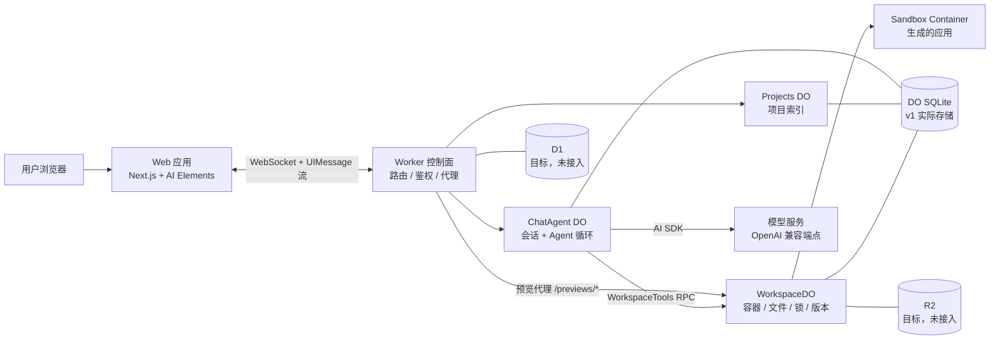
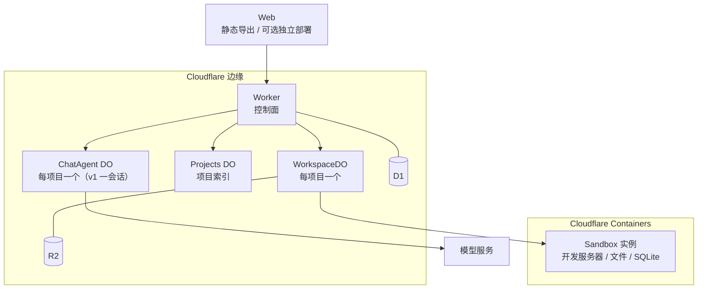
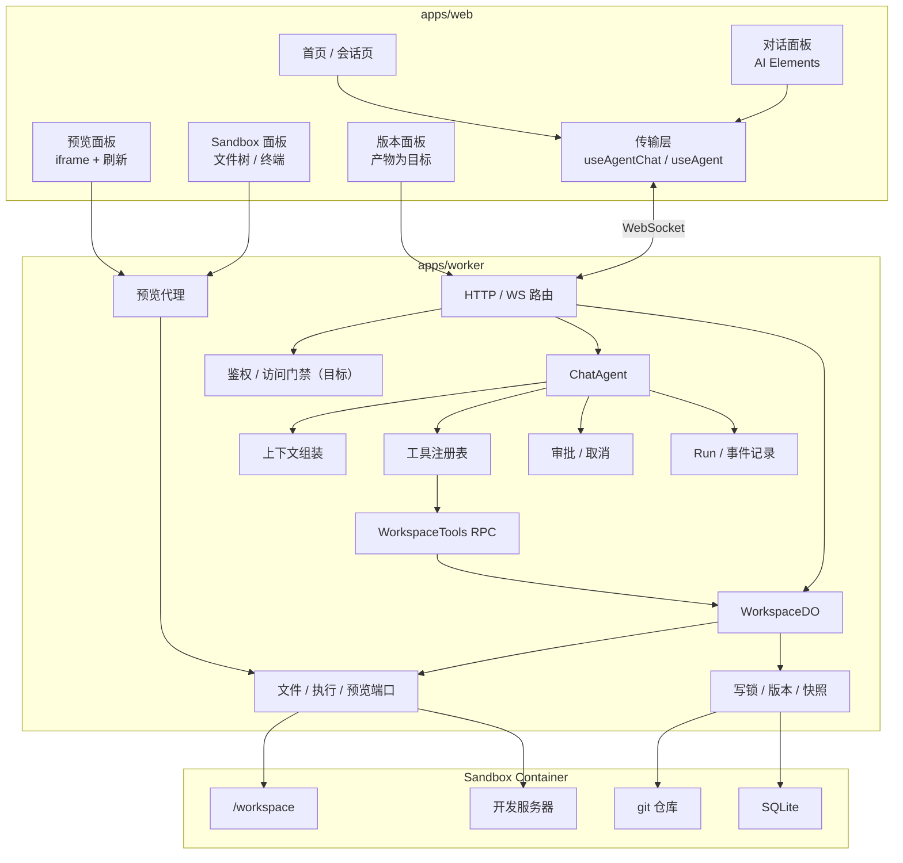
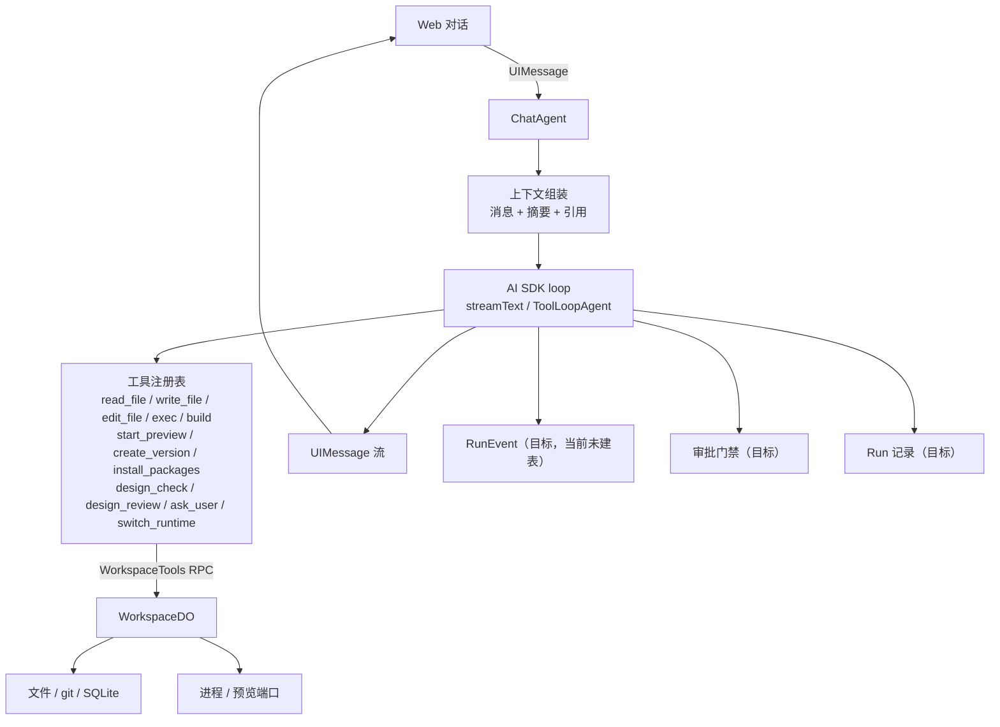
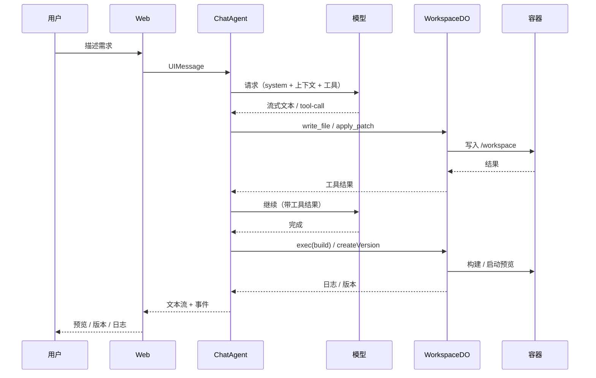
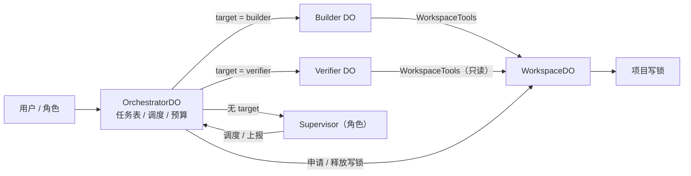

# atoms-lite 系统架构

状态：**v1 设计基线**（2026-11-19；2026-11-20 与实现校对）
相关文档：`docs/decisions/`（实现约束）、`docs/poc/`（验证记录）

> 本文描述目标架构。当前 v1 实际使用 **Projects DO + ChatAgent DO + WorkspaceDO + Container**，
> **D1 / R2 / Queues / 多角色尚未接入**；实现细节与验证记录以 `docs/implementation.md` 为准。
> 与 `docs/atoms-lite-需求与设计.md` 第 8 章（总体架构）冲突时，以本文为准。

---

## 1. 目标与边界

atoms-lite 是一个对话式应用生成平台：用户用自然语言描述需求，Agent 在隔离工作区中读写代码、执行命令、构建并启动预览，最终产出一个可运行的多文件 Web 应用，并支持版本回滚。导出/发布是后续目标。

**架构边界**：

- 控制面（Worker / DO）不执行模型生成的代码；
- 生成代码只在 Sandbox 容器内运行；
- 模型密钥、平台密钥不进 Sandbox；
- 预览通过 Worker 代理，不直接暴露容器端口。

**v1 不做**：多角色运行时、PPT 产物、Markdown 之外的富文本、连接器、多会话并行写。

---

## 2. 系统上下文图



要点：

- **Web 与 Worker 代码上是两个包**，开发时是两个进程；生产 Web 静态导出由 Worker assets 提供，
  也可以拆成独立部署。
- **ChatAgent 与 WorkspaceDO 是两个业务 DO**：前者管会话与 Agent，后者管容器与工作区；
  另有单例 `Projects` DO 负责项目索引。
- 角色不直接持有容器（见第 5 节）。

---

## 3. 部署拓扑



| 单元 | 数量 | 职责 |
|---|---|---|
| Web | 1 | 只负责渲染与交互，不持有业务状态；生产作为 Worker assets 部署 |
| Worker | 1 | 路由、预览代理、WebSocket；鉴权/门禁为后续目标 |
| Projects DO | 1 | v1 项目索引（替代 D1 的项目列表）；读取时向各 WorkspaceDO 补齐版本摘要 |
| ChatAgent DO | 每项目 1 | Agent 循环、上下文、工具、审批、事件；v1 一项目一会话 |
| WorkspaceDO | 每项目 1 | 容器生命周期、文件、执行、写锁、git、版本、快照 |
| Sandbox | 每项目 1（按需启动） | 运行生成的应用 |

---

## 4. 组件图



### 组件职责

| 组件 | 职责 | 不负责 |
|---|---|---|
| Web 对话面板 | 渲染消息/工具/审批，发送输入 | 不持久化、不调模型 |
| Web 预览面板 | iframe、刷新、错误提示 | 不执行代码 |
| Worker 路由 | 连接、路由、预览代理 | 不跑 Agent；鉴权/门禁为后续 |
| ChatAgent | 模型循环、工具选择、上下文、事件 | 不直接操作容器 |
| WorkspaceDO | 容器、文件、exec、锁、版本、快照 | 不做模型调用 |
| Sandbox | 运行生成应用 | 不持有平台密钥 |

---

## 5. Agent 架构

### 5.1 单角色循环（v1）



- 编排使用 **Agents SDK + AI SDK**，不引入 LangGraph。
- 工具执行的唯一位置是 `WorkspaceDO`；ChatAgent 只发 RPC。
- 流式输出走 `useAgentChat`（UIMessage），面板状态走 `useAgent`。

### 5.2 一次生成的时间线



### 5.3 多角色（后续，接口已预留）



- 协调者是**代码路由 + supervisor 兜底**，不是每步一次模型调用。
- 角色各自独立 DO、独立上下文；不持有容器。
- 写冲突方案暂缓；v1 串行。详见 `docs/decisions/02`。

### 5.4 Run 与 Drill-in

> **目标设计**：v1 没有 `atoms_runs` / `atoms_run_events` 表，也没有 drill-in UI。
> 下面结构用于多角色和可观测性落地。

```
Run
  ├─ id / role / sessionId / taskId
  ├─ parentRunId （单角色为 null）
  ├─ status / summary / usage
  └─ events / artifacts
```

单角色、subagent、多角色共用同一套 Run 树；UI 的 drill-in 只是"选中某个 run 看详情"。

---

## 6. 数据与存储

> 表结构、字段说明、R2 布局、保留与 GC 见 [`data-model.md`](./data-model.md)。

| 存储 | 内容 |
|---|---|
| **D1（目标，未接入）** | 项目、会话元数据、产物索引、导出记录 |
| **DO SQLite（Projects）** | v1 项目索引：项目名、prompt、模板、runtime、configured、时间 |
| **DO SQLite（ChatAgent）** | 消息、流式分片、压缩记录；框架 `cf_*` 表 |
| **DO SQLite（WorkspaceDO）** | 版本、快照指针、文件列表缓存、browser 文件/版本/依赖、migration |
| **R2（目标，未接入）** | 附件、导出包、日志 |
| **平台快照** | 容器 rootfs（用于停/起恢复，不作为版本） |
| **Secret Store** | 模型密钥、第三方凭据（不进入 sandbox） |

> 框架自建表使用 `cf_*` 前缀；业务表使用 `atoms_` 前缀，禁止修改框架表结构。

---

## 7. 关键流程

### 7.1 生成与预览

1. 用户消息 → ChatAgent → 模型（带工具）。
2. 工具调用 → `WorkspaceDO` → 容器内写文件 / 执行命令。
3. 构建成功后确保 preview 服务可用；static / React 由静态 server 读磁盘，全栈 Node 进程需要重启。
4. Worker 通过 `/previews/:project/*` 代理到容器。
5. 成功后创建版本（git commit + 元数据行；browser 项目用内容哈希）。

### 7.2 版本与回滚

- 版本 = git commit + 一行元数据（`git_commit`，不是 `commit`）；browser 项目用内容 SHA-256。
- 回滚 = 先自动保存未提交改动，再用 `git read-tree` 恢复目标树，创建新的 rollback commit；
  禁止 `reset --hard` / `git clean` 破坏历史。
- checkout 后校验 Git HEAD 与 currentVersion，避免快照与版本指针不一致。
- 版本切换不恢复快照（只回代码，不回数据）。
- 容器停止时版本列表仍可渲染（只查元数据）。

### 7.3 附件（目标，未实现）

- 二进制存 R2，消息只存 `artifactId`。
- 模型调用前才物化为 data URL。
- 需要被生成应用使用时，投放到 `/workspace/public/uploads/`。
- 跨角色通过 `ContextRef` 引用，不传 base64。

---

## 8. 失败与降级

| 失败 | 表现 | 处理 |
|---|---|---|
| 模型超时 / 限流 | 流中断 | 重试 + 明确错误；保留已生成内容 |
| 构建失败 | 预览不可用 | 把日志回给模型修复；UI 显示失败态 |
| 容器启动失败 | 工具全部失败 | 显式报错，不回退到空工作区 |
| 快照丢失 | 恢复失败 | 报错并提供导出/重建路径 |
| 预览不可达 | iframe 空白 | 显示错误与刷新入口；必要时降级为静态预览 |
| 写锁超时 | 任务排队过久 | 租约过期回收 + 队列 FIFO |

---

## 9. 安全边界

- 生成代码视为不可信：只在容器内运行，不接触平台密钥。
- 路径规范化，禁止越出 `/workspace`；命令走程序+参数策略。
- 预览与主站同源时有逃逸风险：iframe 加 `sandbox`，生产应使用独立子域。
- 附件做 MIME/大小/文件名校验；上传目录只读（附件尚未接入）。
- 日志不记录密钥、完整 prompt 与用户附件内容。
- **v1 演示版没有鉴权与预算上限**；Worker 路由中的鉴权/门禁为后续目标。

---

## 10. 通信与协议

| 通道 | 协议 | 用途 |
|---|---|---|
| 对话流 | **WebSocket**（`useAgentChat`，UIMessage chunks） | 消息、工具调用、审批、停止/续传 |
| 面板状态 | **WebSocket**（`useAgent`，DO state 同步） | 预览状态、版本、Sandbox、Run |
| 业务 CRUD | HTTP JSON | 项目/会话/版本/产物/导出 |
| 预览 | HTTP 代理 + WebSocket | iframe 资源；HMR |
| 附件 | HTTP multipart + 签名 URL | 上传/下载 |
| 模型调用 | HTTPS（服务端） | AI SDK → provider |

### 为什么用 WebSocket 而不是 SSE

- Durable Object 原生支持 WebSocket（含 hibernation），连接即会话，天然带断线重连与事件重放；
- 对话流与面板状态共用一条连接，不需要两套推送；
- 双向：审批、停止、RPC 都可以走同一通道。

SSE 不是不可行：AI SDK 的 `useChat` 支持自定义 `ChatTransport`，可以改走 HTTP SSE。
代价是要自己实现续传（cursor / replay）和面板状态的独立推送。**v1 用 WebSocket；
如果面试官网络对 WS 不友好，再加 SSE 回退**（UIMessage chunk 格式不变，只换传输）。

## 11. 未定与风险

| 项 | 说明 |
|---|---|
| 生产 Containers 一致性 | 已验证（静态、React、全栈模板均在生产跑通） |
| 多文件生成闭环 | 已完成（模型 → 工具 → 构建 → 预览 → 版本） |
| 构建型模板 | 依赖镜像预装；新增 npm 依赖可通过 `install_packages` 在线安装 |
| 全栈数据 | 容器 SQLite + 快照保留；长期持久化需 D1/R2 |
| 写冲突方案 | v1 串行；锁模型已设计，未实现 |
| B6 面板事件并行 | 未验证 |
| 成本控制 | 单次约 40k tokens（单文件基线），需 maxSteps + 预算上限 |
| 附件 API | 未实现；当前没有 R2 接入 |
| D1 / R2 / Queues | 目标设计，v1 未接入 |
