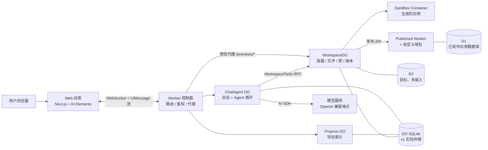
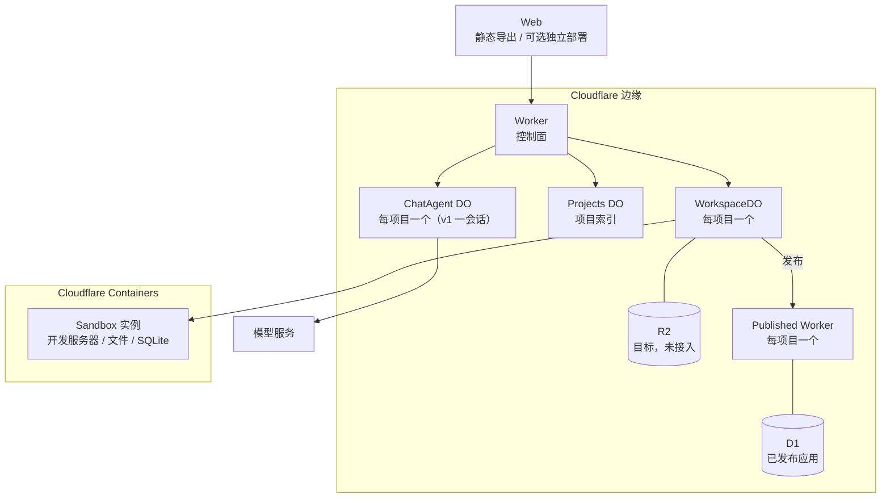
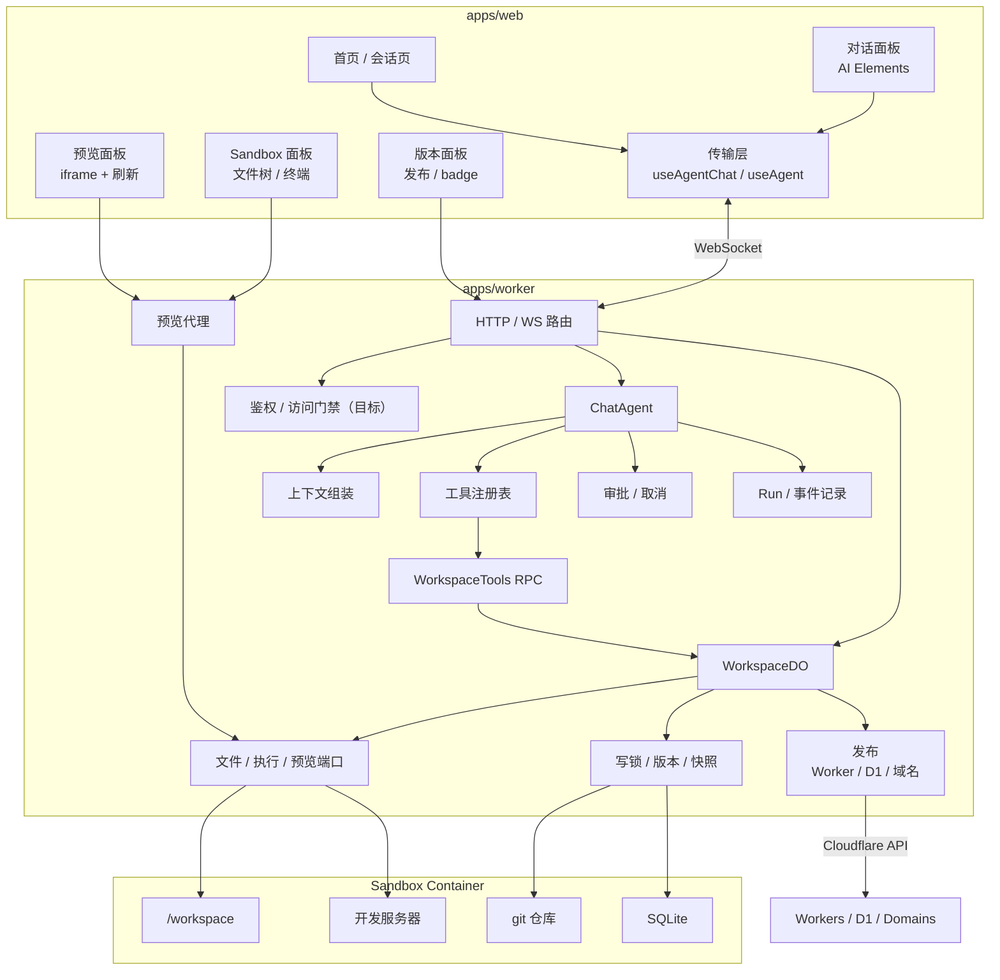
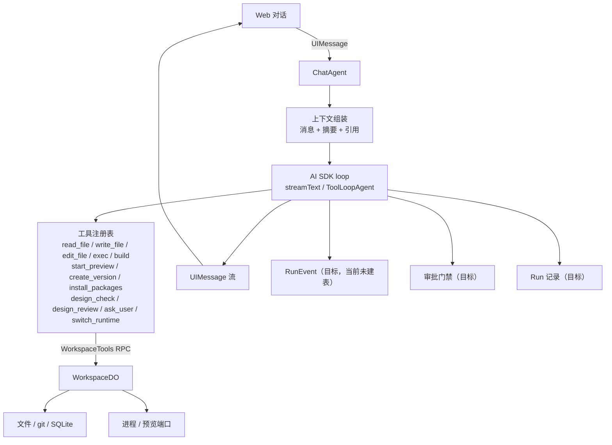
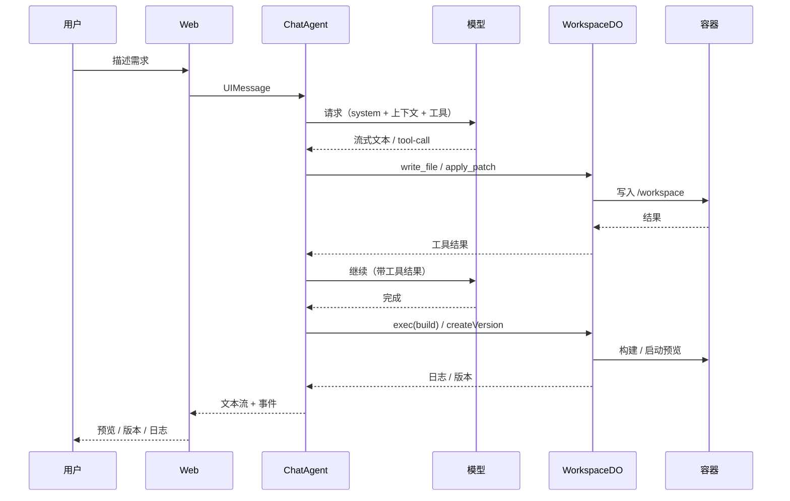
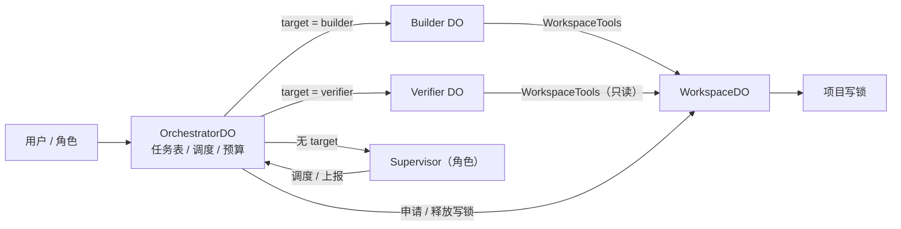
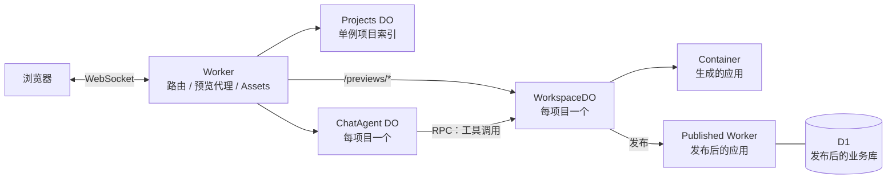

# atoms-lite 系统架构

状态：**v1 设计基线**（2026-11-19；2026-11-20 与实现校对，含版本发布）
相关文档：`docs/decisions/`（实现约束）、`docs/poc/`（验证记录）

> 本文描述目标架构。当前 v1 实际使用 **Projects DO + ChatAgent DO + WorkspaceDO + Container**，
> 并支持把版本发布到 **Cloudflare Workers**；全栈项目发布时使用 **D1**。
> **平台元数据仍未使用 D1/R2/Queues，多角色尚未接入**；实现细节与验证记录以
> `docs/implementation.md` 为准。
> 不熟悉 Cloudflare 的读者可以先看第 12 节「Cloudflare 服务说明」，尤其是 Durable Objects。

> **术语**：**模板（template）** 指 `static` / `react-vite` / `fullstack-hono`；
> **运行环境（runtime）** 指项目实际在哪里执行：`browser`（Worker 直接服务）或 `container`（容器），
> 不是 Node/V8 语言运行时；**沙箱** 指 `container` 运行环境里的隔离容器。
> 与 `docs/atoms-lite-需求与设计.md` 第 8 章（总体架构）冲突时，以本文为准。

---

## 1. 目标与边界

atoms-lite 是一个对话式应用生成平台：用户用自然语言描述需求，Agent 在隔离工作区中读写代码、执行命令、构建并启动预览，最终产出一个可运行的多文件 Web 应用，并支持版本回滚和发布到 Cloudflare Workers（全栈项目使用 D1）。

**架构边界**：

- 控制面（Worker / DO）不执行模型生成的代码；
- 生成代码只在 Sandbox 容器内运行；
- 模型密钥、平台密钥不进 Sandbox；
- 预览通过 Worker 代理，不直接暴露容器端口。

**v1 不做**：多角色运行时、PPT 产物、Markdown 之外的富文本、连接器、多会话并行写。

---

## 2. 系统上下文图



要点：

- **Web 与 Worker 代码上是两个包**，开发时是两个进程；生产 Web 静态导出由 Worker assets 提供，
  也可以拆成独立部署。
- **ChatAgent 与 WorkspaceDO 是两个业务 DO**：前者管会话与 Agent，后者管容器与工作区；
  另有单例 `Projects` DO 负责项目索引。
- 角色不直接持有容器（见第 5 节）。

---

## 3. 部署拓扑



| 单元 | 数量 | 职责 |
|---|---|---|
| Web | 1 | 只负责渲染与交互，不持有业务状态；生产作为 Worker assets 部署 |
| Worker | 1 | 路由、预览代理、WebSocket；鉴权/门禁为后续目标 |
| Projects DO | 1 | v1 项目索引（替代 D1 的项目列表）；读取时向各 WorkspaceDO 补齐版本摘要 |
| ChatAgent DO | 每项目 1 | Agent 循环、上下文、工具、审批、事件；v1 一项目一会话 |
| WorkspaceDO | 每项目 1 | 容器生命周期、文件、执行、写锁、git、版本、快照、发布 |
| Sandbox | 每项目 1（按需启动） | 运行生成的应用 |
| Published Worker | 每项目 1 | 发布后的生成应用；静态资源内嵌，全栈绑定项目 D1 |
| 项目 D1 | 每个已发布全栈项目 1 | 生成应用的业务数据库 |

---

## 4. 组件图



### 组件职责

| 组件 | 职责 | 不负责 |
|---|---|---|
| Web 对话面板 | 渲染消息/工具/审批，发送输入 | 不持久化、不调模型 |
| Web 预览面板 | iframe、刷新、错误提示 | 不执行代码 |
| Worker 路由 | 连接、路由、预览代理 | 不跑 Agent；鉴权/门禁为后续 |
| ChatAgent | 模型循环、工具选择、上下文、事件 | 不直接操作容器 |
| WorkspaceDO | 容器、文件、exec、锁、版本、快照、发布 | 不做模型调用 |
| Sandbox | 运行生成应用 | 不持有平台密钥 |

---

## 5. Agent 架构

### 5.1 单角色循环（v1）



- 编排使用 **Agents SDK + AI SDK**，不引入 LangGraph。
- 工具执行的唯一位置是 `WorkspaceDO`；ChatAgent 只发 RPC。
- 流式输出走 `useAgentChat`（UIMessage），面板状态走 `useAgent`。

### 5.2 一次生成的时间线



### 5.3 多角色（后续，接口已预留）



- 协调者是**代码路由 + supervisor 兜底**，不是每步一次模型调用。
- 角色各自独立 DO、独立上下文；不持有容器。
- 写冲突方案暂缓；v1 串行。详见 `docs/decisions/02`。

### 5.4 Run 与 Drill-in

> **目标设计**：v1 没有 `atoms_runs` / `atoms_run_events` 表，也没有 drill-in UI。
> 下面结构用于多角色和可观测性落地。

```
Run
  ├─ id / role / sessionId / taskId
  ├─ parentRunId （单角色为 null）
  ├─ status / summary / usage
  └─ events / artifacts
```

单角色、subagent、多角色共用同一套 Run 树；UI 的 drill-in 只是"选中某个 run 看详情"。

---

## 6. 数据与存储

> 表结构、字段说明、R2 布局、保留与 GC 见 [`data-model.md`](./data-model.md)。

| 存储 | 内容 |
|---|---|
| **D1（已发布应用）** | 每个已发布全栈项目一个业务数据库；平台项目/会话元数据仍未接入 |
| **DO SQLite（Projects）** | v1 项目索引：项目名、prompt、模板、runtime、configured、时间；Token 用量明细与每日全站汇总 |
| **DO SQLite（ChatAgent）** | 消息、流式分片、压缩记录；框架 `cf_*` 表 |
| **DO SQLite（WorkspaceDO）** | 版本、快照指针、文件列表缓存、browser 文件/版本/依赖、migration、构建产物、发布记录 |
| **R2（目标，未接入）** | 附件、导出包、日志 |
| **平台快照** | 容器 rootfs（用于停/起恢复，不作为版本） |
| **Secret Store** | 模型密钥、Cloudflare 发布 token（不进入 sandbox） |

> 框架自建表使用 `cf_*` 前缀；业务表使用 `atoms_` 前缀，禁止修改框架表结构。

---

## 7. 关键流程

### 7.1 生成与预览

1. 用户消息 → ChatAgent → 模型（带工具）。
2. 工具调用 → `WorkspaceDO` → 容器内写文件 / 执行命令。
3. 构建成功后确保 preview 服务可用；static / React 由静态 server 读磁盘，全栈 Node 进程需要重启。
4. Worker 通过 `/previews/:project/*` 代理到容器。
5. 成功后创建版本（git commit + 元数据行；browser 项目用内容哈希）。

### 7.2 版本与回滚

- 版本 = git commit + 一行元数据（`git_commit`，不是 `commit`）；browser 项目用内容 SHA-256。
- 回滚 = 先自动保存未提交改动，再用 `git read-tree` 恢复目标树，创建新的 rollback commit；
  禁止 `reset --hard` / `git clean` 破坏历史。
- checkout 后校验 Git HEAD 与 currentVersion，避免快照与版本指针不一致。
- 版本切换不恢复快照（只回代码，不回数据）。
- 容器停止时版本列表仍可渲染（只查元数据）。

### 7.3 附件（目标，未实现）

- 二进制存 R2，消息只存 `artifactId`。
- 模型调用前才物化为 data URL。
- 需要被生成应用使用时，投放到 `/workspace/public/uploads/`。
- 跨角色通过 `ContextRef` 引用，不传 base64。

### 7.4 发布版本

1. 版本创建时收集构建产物到 `atoms_build_files`：
   static 收集 dist/browser 文件；fullstack 额外收集 `migrations/` 和 `.atoms-lite/worker.js`。
2. 发布时读取项目固定的目标：slug、Worker、D1、hostname（`atoms_project_config`）。
3. 全栈项目先把目标版本缺失的 migration 应用到 D1；如果 D1 已应用的 migration
   不在目标版本中，拒绝发布。
4. 上传 Worker：
   - static/React：把 dist 资源内嵌到生成的 Worker 脚本。
   - fullstack：上传 `.atoms-lite/worker.js`，脚本内嵌 dist 资源，绑定 `DB`。
5. 通过 Workers Domains API（`PUT`）绑定 `<slug>.atoms-lite.fengyj.me`；
   失败时降级到 workers.dev，并把原因写进部署记录。
6. 写 `atoms_deployments`；最新 `status = ready` 即当前线上版本，版本面板显示 badge。
7. 取消发布删除 domain 和 Worker，保留 D1，把当前 `ready` 标为 `unpublished`；
   首页项目卡通过 `/meta` 显示已发布 badge。

### 7.5 模型用量、费用与每日限额

- 主对话的每个 step、planner、项目自动命名、subagent、compaction 都写一条 usage 明细。
- 明细和每日全站汇总存放在 `Projects` DO：
  `atoms_usage_events`、`atoms_usage_daily`。
- 字段包括 input/output、cache read/write、no-cache、reasoning、total、
  model、source、requestId、step、cost、day。
- `GET /api/projects/:id/usage` 返回会话/项目/今日/最近每日/今日全站/限额；
  会话页顶栏展示本会话累计。
- 默认每日费用上限 **$1**（`DAILY_COST_LIMIT_USD`），预留 `$0.05`
  防止单轮透支；按 `USAGE_TIMEZONE` 切日。
- 额度判断只发生在下一轮请求开始前，不中断进行中的回合；额度不足时 UI 禁用输入框
  并显示临时横幅。
- 回合中剩余额度低于预留值时，给模型注入“预算提醒”，要求它总结进度和下一步后停止，
  不再调用工具。
- 价格默认使用 OpenCode Go `deepseek-v4.1-flash` 的内置价，
  `MODEL_PRICING_JSON` 可覆盖。
- 上下文压缩按模型上下文比例触发（大窗口 50%、小窗口 65%），
  当前 1M 模型约 500k 触发；压缩调用同样记账。
- 用量查询失败时 fail-open，避免统计故障导致站点不可用。

---

## 8. 失败与降级

| 失败 | 表现 | 处理 |
|---|---|---|
| 模型超时 / 限流 | 流中断 | 重试 + 明确错误；保留已生成内容 |
| 构建失败 | 预览不可用 | 把日志回给模型修复；UI 显示失败态 |
| 容器启动失败 | 工具全部失败 | 显式报错，不回退到空工作区 |
| 快照丢失 | 恢复失败 | 报错并提供导出/重建路径 |
| 预览不可达 | iframe 空白 | 显示错误与刷新入口；必要时降级为静态预览 |
| 发布 Worker / D1 失败 | 部署记录 `failed` | 保留上一条 `ready` 版本，版本面板显示错误 |
| 目标版本缺 D1 已应用 migration | 发布被拒绝 | 不自动回滚数据库；提示需新版本或手工处理 |
| 自定义域名绑定失败 | 部署仍 `ready`，URL 为 workers.dev | 记录 `domain_error`，UI 显示警告 |
| 写锁超时 | 任务排队过久 | 租约过期回收 + 队列 FIFO |

---

## 9. 安全边界

- 生成代码视为不可信：只在容器内运行，不接触平台密钥。
- 路径规范化，禁止越出 `/workspace`；命令走程序+参数策略。
- 预览与主站同源时有逃逸风险：iframe 加 `sandbox`，生产应使用独立子域。
- 附件做 MIME/大小/文件名校验；上传目录只读（附件尚未接入）。
- 日志不记录密钥、完整 prompt 与用户附件内容。
- **v1 演示版没有鉴权与预算上限**；Worker 路由中的鉴权/门禁为后续目标。

---

## 10. 通信与协议

| 通道 | 协议 | 用途 |
|---|---|---|
| 对话流 | **WebSocket**（`useAgentChat`，UIMessage chunks） | 消息、工具调用、审批、停止/续传 |
| 面板状态 | **WebSocket**（`useAgent`，DO state 同步） | 预览状态、版本、Sandbox、Run |
| 业务 CRUD | HTTP JSON | 项目/会话/版本/产物/导出 |
| 预览 | HTTP 代理 + WebSocket | iframe 资源；HMR |
| 附件 | HTTP multipart + 签名 URL | 上传/下载 |
| 模型调用 | HTTPS（服务端） | AI SDK → provider |

### 为什么用 WebSocket 而不是 SSE

- Durable Object 原生支持 WebSocket（含 hibernation），连接即会话，天然带断线重连与事件重放；
- 对话流与面板状态共用一条连接，不需要两套推送；
- 双向：审批、停止、RPC 都可以走同一通道。

SSE 不是不可行：AI SDK 的 `useChat` 支持自定义 `ChatTransport`，可以改走 HTTP SSE。
代价是要自己实现续传（cursor / replay）和面板状态的独立推送。**v1 用 WebSocket；
如果面试官网络对 WS 不友好，再加 SSE 回退**（UIMessage chunk 格式不变，只换传输）。

## 11. 未定与风险

| 项 | 说明 |
|---|---|
| 生产 Containers 一致性 | 已验证（静态、React、全栈模板均在生产跑通） |
| 多文件生成闭环 | 已完成（模型 → 工具 → 构建 → 预览 → 版本） |
| 构建型模板 | 依赖镜像预装；新增 npm 依赖可通过 `install_packages` 在线安装 |
| 全栈数据 | 预览/开发使用容器 SQLite + 快照；发布后的应用使用独立 D1 |
| 版本发布 | 已完成 static/React/fullstack 的 Workers + D1 + 自定义域名发布与清理 |
| Token 用量 | 主对话/planner/自动命名/subagent/compaction 已记账；会话/项目/每日全站可查；默认 $1/天限额 |
| 发布环境 | 只有项目级生产环境；预发、多区域、回滚数据库未支持 |
| 写冲突方案 | v1 串行；锁模型已设计，未实现 |
| B6 面板事件并行 | 未验证 |
| 成本控制 | 单次约 40k tokens（单文件基线），需 maxSteps + 预算上限 |
| 附件 API | 未实现；当前没有 R2 接入 |
| R2 / Queues | 目标设计，v1 未接入；D1 仅用于已发布应用 |

---

## 12. Cloudflare 服务说明

这一节给不熟悉 Cloudflare 的读者做对照。重点解释 **Durable Objects（DO）**：
它是这套架构里最不像传统云服务的部件，也是 `ChatAgent`、`WorkspaceDO`、`Projects` 的基础。

### 12.1 一张表看懂

| Cloudflare 服务 | 它是什么 | 最接近的其他云服务 | 本项目怎么用 |
|---|---|---|---|
| **Workers** | 边缘运行的 V8 isolate，请求级无状态计算 | AWS Lambda / Cloud Functions / Edge Functions | 平台路由、预览代理；也为每个发布项目上传独立 Worker |
| **Durable Objects** | 有唯一 ID、单实例、带持久化存储和 WebSocket 的有状态对象 | 没有完全等价的单一服务；最接近 Actor 模型（Akka / Orleans）、Azure Durable Entities | 每个项目一个 `WorkspaceDO`、一个 `ChatAgent`；单例 `Projects` |
| **DO SQLite** | 每个 DO 内嵌的事务型 SQLite | 每个分片一份小数据库 / LibSQL / 嵌入式 SQLite | 项目索引、版本、文件缓存、快照指针、构建产物、发布记录、Token 用量 |
| **Containers** | 由 DO 调度和持有的长驻容器 | ECS / Cloud Run / Fly Machines | 运行生成的应用，执行 build / shell / 预览服务 |
| **D1** | 托管 SQLite，面向关系型元数据 | Aurora Serverless / Turso / 托管 SQLite | 每个已发布全栈项目一个业务库；平台元数据未接入 |
| **R2** | S3 兼容对象存储，出站流量免费 | AWS S3 / GCS | **v1 未接入**；目标用于附件、导出包、日志 |
| **KV** | 边缘最终一致键值存储 | DynamoDB / Redis（但一致性模型不同） | 未使用 |
| **Queues** | 至少一次投递的消息队列 | SQS / Pub/Sub | 未使用 |
| **Workflows** | 持久化多步工作流 | Step Functions / Temporal | 未使用 |
| **Assets** | 静态站点托管 | S3 + CloudFront | 托管平台 Web；发布项目的静态资源内嵌在各自 Worker |
| **Workers Domains** | 给 Worker 绑定自定义域名，自动管理 DNS/证书 | 负载均衡 + 证书管理 | `<slug>.atoms-lite.fengyj.me` |
| **Secrets** | Worker 加密环境变量 | Secrets Manager / SSM Parameter Store | 模型 API Key、Cloudflare 发布 token |
| **DO Alarms** | DO 内的定时回调 | EventBridge Scheduler / cron | 全栈写入后延迟 10s 触发快照 |

### 12.2 Durable Objects 特殊在哪

传统云服务通常把「计算、状态、锁、连接、定时任务」拆成不同产品：

```text
Lambda + Redis（锁/状态） + RDS（数据） + API Gateway WebSocket + SQS + Cron
```

DO 把这些收进一个原语：

```text
一个 ID
  ├─ 单实例、单线程执行
  ├─ 内嵌事务型 SQLite
  ├─ WebSocket 连接与休眠
  ├─ Alarms 定时回调
  ├─ RPC 调用其他 DO
  └─ 可绑定一个 Container
```

关键特性：

- **按 ID 路由到唯一实例**：`idFromName(projectId)` 保证同一个项目永远落到同一个 DO。
  不需要外部服务做服务发现或一致性哈希。
- **单线程 + 强一致**：同一个 DO 内的请求串行执行，天然适合做「单写者」。
  本项目用它把同一项目的工具调用、版本创建、checkout 串行化，避免并发写 git。
- **状态和计算在一起**：`WorkspaceDO` 既保存版本/快照指针，又持有容器；
  不需要「先查数据库，再调另一个服务操作容器」的分布式协调。
- **WebSocket 可休眠**：`ChatAgent` 可以保持会话连接，空闲时休眠，消息到达再唤醒；
  比「API Gateway WebSocket + 外部会话表」少一层状态同步。
- **Alarms**：可以在未来某个时间点唤醒自己，本项目用它做全栈写入后的延迟快照。
- **RPC**：`ChatAgent` 可以直接调用 `WorkspaceDO` 的工具方法，不需要经过公网。

它**不是**什么：

- 不是数据库：DO SQLite 是每个对象内嵌的库，不是全局可查询的数据库。
- 不是容器：Container 是被 DO 调度和持有的执行环境，DO 本身不跑生成代码。
- 不是万能全局锁：单对象吞吐有上限；项目多了要按项目/会话分片，不能把所有项目塞进一个 DO。
- 不是 Lambda：DO 有稳定身份和持久状态，生命周期比一次请求长。

### 12.3 本项目里的对象划分



| 对象 | 为什么是 DO | 不用 DO 会怎样 |
|---|---|---|
| `ChatAgent` | 会话消息、流式状态、WebSocket、模型循环需要稳定身份 | 需要外部会话表 + 连接网关 + 续传逻辑 |
| `WorkspaceDO` | 同一项目的写操作必须串行；容器生命周期需要唯一持有者 | 需要分布式锁、容器注册表、额外协调服务 |
| `Projects` | v1 的项目列表只需要一个单例索引 | 可以直接用 D1；规模大时应该迁移 |
| `Published Worker` | 发布后独立于平台和容器运行，请求不再经过 WorkspaceDO | 只能靠容器常驻提供公网访问，成本和可靠性都更差 |

### 12.4 为什么平台元数据没有用 D1 / R2 / Queues / Workflows

不是这些服务不需要，而是当前规模可以更简单：

- **D1**：平台侧单用户、少量项目，`Projects` DO 足够提供列表；D1 的价值在多用户、全局查询和规模化。
  注意：**发布后的全栈应用已经使用 D1**，那是生成应用的业务库，不是平台元数据。
- **R2**：平台附件和导出还没实现；生成应用内部的用户上传由应用自己写入容器，随快照保留。
- **Queues / Workflows**：当前 Agent 是单轮工具循环，构建和快照都在请求生命周期内完成；
  引入异步队列会多一套任务状态和重试语义。
- **KV**：没有需要最终一致、超低延迟的全局配置。

代价也明确：

- 单例 `Projects` DO 是热点，首页需要 N 次 DO 读取；
- DO SQLite 有单对象存储/吞吐上限，不适合放大量二进制（发布产物上限约 12 MiB/版本）；
- 容器快照不是长期数据库，跨实例恢复应换 D1/R2；发布后的全栈应用已改用 D1。

### 12.5 常见误区

- **“DO 就是数据库”**：DO 是带状态的计算对象，SQLite 只是它的一种存储能力。
- **“DO 就是容器”**：容器是 DO 管理的执行环境；DO 负责身份、状态和协调。
- **“Worker 是常驻服务器”**：Worker 是请求级 isolate，不能依赖进程内全局状态。
- **“Container 就是 Lambda”**：Container 是长驻的，有磁盘和进程；Lambda 是短时函数。
- **“R2 是文件系统”**：R2 是对象存储，不适合随机读写、追加写和文件锁。
- **“D1 可以替代 DO”**：D1 解决全局关系型查询，不提供单对象的串行协调和 WebSocket。
- **“发布 Worker 就是平台 Worker”**：发布后的应用是独立 Worker（全栈还绑定独立 D1），
  和 `atoms-lite` 控制面 Worker 分离；删除项目时按 domain → Worker → D1 顺序清理。
