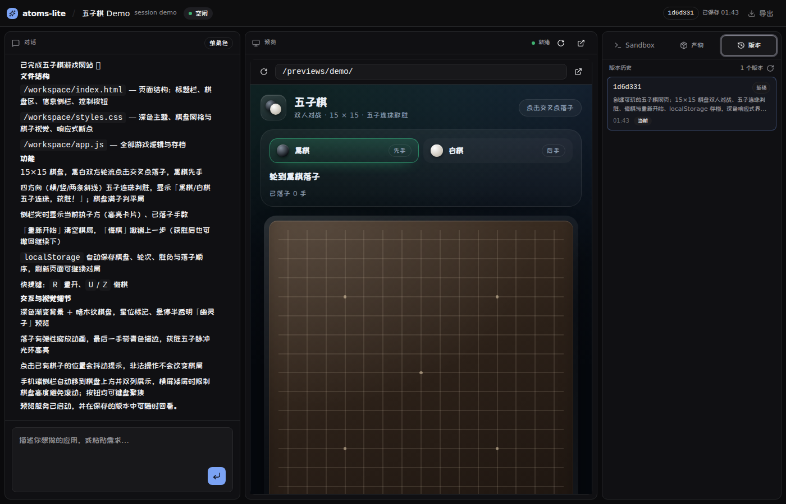
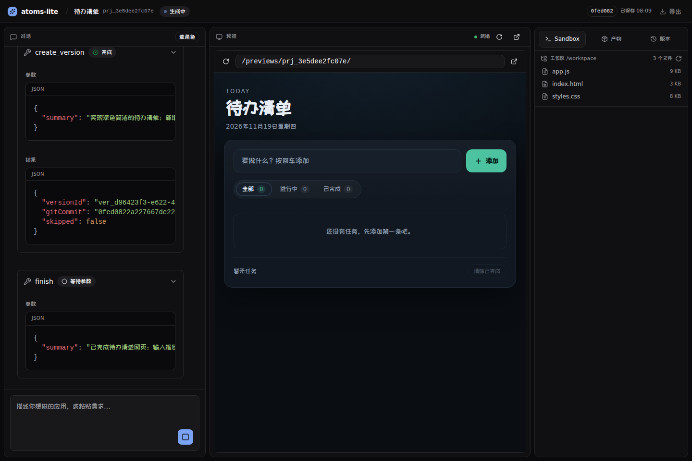
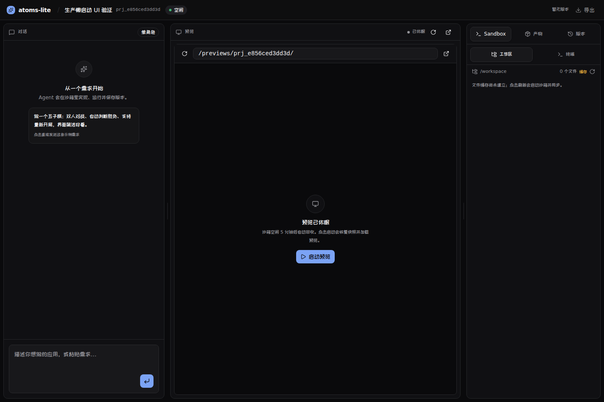
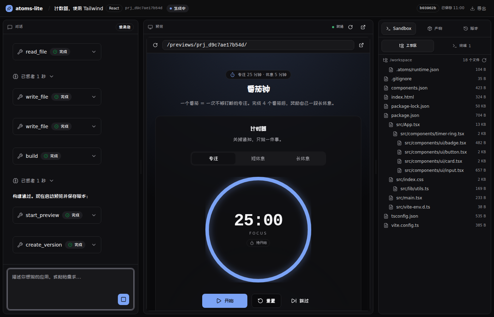
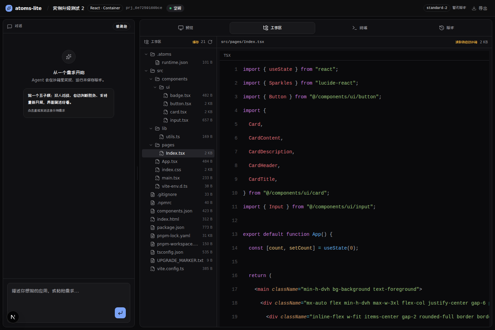

# A/B/C 实现记录（单角色 · 多运行时生成器）

状态：**已实现并部署**（2026-11-19；2026-11-21 文档校对，含版本发布与用量统计）

## 1. 范围

- 两个页面：**首页工作台** `/` 与**会话工作区** `/sessions/:projectId`
- **多项目**：首页每次提交需求都会创建一个独立项目（独立容器、文件、git、版本、会话）
- 用户输入需求 → ChatAgent 调工具 → WorkspaceDO 写文件 → 启动预览 → 创建版本
- **三种项目模板、两种运行时**：
  - `static` + **browser**：Web 文件存 DO SQLite，平台直接服务，无容器；依赖通过 esm.sh importmap
  - `react-vite` + container：React 19 + TypeScript + Vite 8 + Tailwind CSS v4 + shadcn/ui + HashRouter（`src/pages/Index.tsx`）
  - `fullstack-hono` + container：上面的前端 + 共享 Hono API（`server/app.js`）+
    `node:sqlite`（本地）/ D1（发布）双适配器 + `migrations/*.sql`
  - 旧静态项目仍使用 container 运行环境（兼容）
- 项目创建时根据需求自动选择模板并持久化
- 目标示例：五子棋（静态）、番茄钟（React）、带优先级的待办（全栈）

A/B 完成三种模板与构建/预览闭环；C 完成智能选型、browser-static 运行时、
依赖安装与开放 egress。首页不再提供手动技术栈下拉；API 仍保留 `preferredTemplate`
参数用于调试/兼容。Next.js 已明确不支持（容器实例与构建时间不匹配）。

版本发布已接入：项目可固定发布到 Cloudflare Workers + 自定义域名；全栈项目
同时创建 D1 并应用 `migrations/*.sql`。R2 和平台级 D1 元数据仍未接入；
预览数据仍存在容器内 SQLite（快照保留），与发布后的 D1 是两套数据库。

## 2. 组成

| 组件 | 位置 |
|---|---|
| ChatAgent | `apps/worker/src/agent.ts`（AIChatAgent + AI SDK tools，每项目 1 个实例） |
| WorkspaceDO | `apps/worker/src/workspace/do.ts`（每项目 1 个：容器/文件/版本/快照/发布） |
| 项目索引 | `apps/worker/src/projects.ts`（`Projects` DO，项目元数据 + 版本摘要） |
| Workspace 客户端 | `apps/worker/src/workspace/client.ts` |
| Designer 子 agent | `apps/worker/src/designer.ts`（生成/微调静态概念页，不写生产代码） |
| 发布 | WorkspaceDO → Cloudflare Workers / D1 / Workers Domains API |
| Worker 路由 | `apps/worker/src/index.ts` |
| 沙箱镜像 | `apps/worker/Dockerfile` + `container/` + `container/templates/*` |
| 运行时 supervisor | `apps/worker/container/boot.sh`（静态 / Node 单服务） |
| Web 首页 | `apps/web/components/dashboard/dashboard.tsx` |
| Web 工作区 | `apps/web/components/workspace/*` + `lib/agent.ts` |
| 设计对比面板 | `apps/web/components/workspace/design-panel.tsx` |

架构与决策见 `docs/architecture/`、`docs/decisions/`。

## 2.1 页面结构

```text
/                     首页工作台（dashboard）
/sessions/:projectId  会话工作区（每个项目一个）
```

- `demo` 是 v1 遗留的五子棋项目；新项目 ID 形如 `prj_<12 位>`。
- Next 静态导出只生成一个会话壳 `/sessions/demo`；Worker 把
  `/sessions/<其它 id>` 复用到这个 shell，前端从 `pathname` 读取项目 ID。
- 本地开发用 Next rewrite（`/sessions/prj_:id → /sessions/demo`）模拟。

**首页 `/`**

- Editorial Feature 主题：暖纸底、墨色正文、cobalt 点缀；无左侧栏，改用顶部 masthead
- Masthead：品牌、工作台/项目/模板/设置、Issue 标记、打开工作区 / 新建应用
- Hero：大标题 + 右侧聚焦式需求输入（多行、⌘/Ctrl+Enter；技术栈自动推断）
- 统计条：项目数、版本总数、今日费用（费用来自 `/api/usage/status`）
- 最近项目：一个 featured 项目大卡 + 编辑式项目列表；
  展示真实版本摘要、commit、版本数、发布状态与部署入口
- 右栏：今日预算、运行状态、Editor's note
- 示例需求：五子棋 / 待办清单 / 作品集主页
- 提交需求 → `POST /api/projects` 创建项目 → 跳转 `/sessions/:id?prompt=...`

**会话工作区 `/sessions/:projectId`**

- Editorial Feature 主题：顶部 4px cobalt 色线、纸张面板、衬线项目名
- 两栏：左侧对话；右侧工作台（窄屏底部「对话 / 工作台」切换）
- 工作台顶部 tab：**预览 / 工作区 / 设计 / 终端 / 版本**，使用细线 active 状态
- **设计**：纯展示 Agent 生成的设计草案；没有草案时显示「还没有设计草案」空态。
  窗口内不提供生成、再生成、选择、批注或微调按钮，这些操作都在对话里完成。
  草案用顶部 tab 切换，每个 tab 显示一份草案；下方是标题/论点/色板摘要和实时预览。
  保留 iframe 实时预览、桌面/移动切换、重新加载，以及
  「选择元素」——在草案里点一个元素，把它作为 `selection_source=design` 的上下文带回对话。
  预览前会先 fetch 一次设计稿 URL，404/500 时显示「设计稿加载失败」+ 重试，
  而不是只显示空白 iframe。
- 顶栏：品牌、项目名、模板、项目 ID、运行状态、用量、升级、当前版本
- **打开项目不启动沙箱**：文件列表读 SQL 缓存，预览只探测状态
- 构建型项目在改完源码后调用 build，构建通过再启动预览
- 预览默认显示「预览已休眠」，点击「启动预览」才恢复容器
- 工具调用卡默认折叠，只显示工具名与状态；点击展开参数与结果
- **工作区**：左侧文件树（目录折叠、文件图标、大小），右侧源码查看器
  （行号 + 语法高亮；Shiki 使用 `vitesse-light`）；选择文件会读取内容，容器项目读取时会启动沙箱
- **终端**：从消息里的 `exec` / `build` 工具调用还原 `$ 命令`、stdout/stderr 与 exit code
- **版本**：版本列表带「发布 / 重新发布」按钮；已发布版本显示 badge、访问链接和
  「取消发布」按钮；发布失败保留上一个线上版本，自定义域名失败时显示 workers.dev 警告
- 对话栏支持拖动调整宽度；双击把手恢复默认值，宽度写入 localStorage
- 站内图标文件：`app/icon.svg`（favicon）、`app/apple-icon.png`、页内 `BrandMark`；
  生成项目的图标库约定见 `docs/decisions/07-generated-project-icons.md`
- Agent 实例名 = 项目 ID，因此对话历史、工具调用、容器、版本都按项目隔离
- 进入时读取 `?prompt=`，待 Agent 连接就绪且当前空闲后自动发送；
  发送前用 `history.replaceState` 清掉 query，刷新不会重复发送

首页与工作区之间没有额外的管理页面；设置、版本、文件都在工作区面板内完成。

## 3. 关键行为

- **模板选型**：先走确定性规则（`templates.ts`）：全栈信号（登录/数据库/API/上传…）
  → fullstack；React/SPA/组件/路由 → react-vite；否则 static。
- **模型 planner**：规则拿不准且没有显式技术栈时，调用一次短模型
  （`planner.ts`，严格枚举，12s 超时，0 重试）选择最小模板；失败回退规则。
  显式技术栈/后端信号、五子棋/个人主页等明确静态需求不调用模型。
- **选型可观测**：项目保存 `templateSource`（rule/model/manual/fallback）与
  `planReason`；项目卡 badge 的 tooltip 显示原因，模型选择的 badge 带 Sparkles。
  首页只走自动选型；`manual` 仅保留在 API 路径，不再有 UI 入口。
- **pending / configured**：自动选型项目创建时 `configured=0`，只保存建议模板；
  第一轮由 `ask_user` 确认需求和技术栈，客户端调用 `/configure` 后才挂载文件/构建工具。
  通过 API 手动指定模板的项目直接 `configured=1`。
- **模板配置**：配置写入 WorkspaceDO 的 `atoms_project_config`，不启动容器；
  首次 `ensure()` 按模板播种。配置后、第一次写入前可以重新配置。
- **前端结构**：`src/App.tsx` 是 HashRouter shell，默认首页在 `src/pages/Index.tsx`；
  新页面放 `src/pages` 并在 App.tsx 注册。HashRouter 避免 `/previews/:id/` 路径冲突。
- **需求优先**：需求未确认前不写生产代码、不生成设计稿。Agent 先用 `ask_user` 问清目标用户、
  核心任务、必须内容、约束、成功标准、视觉方向和非目标，再调用
  `manage_requirements(action=save)` 保存；用户确认后调用
  `manage_requirements(action=confirm)`（`atoms_requirements.status=confirmed`）。
- **设计优先**：需求确认后询问用户「先看设计草案 / 直接实现 / 设计延后」。选择先看时调用
  `manage_design(action=create)` 生成 2–5 个结构不同的静态草案（默认 3，最多 5），
  资料进入工作台「设计」tab；该 tab 只负责展示，用户在对话里比较、批注或选择。
  `design_status=review` 期间不写生产代码。
- **设计应用**：用户在对话里选中后 `manage_design(action=select)`（`approved`），
  `manage_design(action=apply)` 把该方向的 `DESIGN.md` 写入工作区并标记 `applied`；
  主 Agent 必须读取 `DESIGN.md` 后再实现。后续 UI 反馈先用
  `manage_design(action=create, mode="revision")` 生成变体，不直接大改生产代码。
- **Designer 子 agent**：`designer.ts` 独立调用模型，不做用户沟通、不写生产代码。
  每个方向单独一次调用（并行执行、硬超时 120s + 精简重试 90s，24k 输出，真实文案、
  真实数据、响应式、纯静态 HTML/CSS，不依赖构建和外部资源）；每完成一个就先落库。
- **设计状态**：`none → review → approved → applied`；需求状态：`draft → confirmed`。
- **预装依赖**：React/全栈模板的 `node_modules` 在镜像构建时 `pnpm install --frozen-lockfile` 安装，
  工作区用软链复用，Agent 不需要也不能执行 pnpm install。
- 镜像内预构建模板的 starter `dist`，新项目首次打开预览即可看到模板；Agent 构建后覆盖。
- **实时连接**：前端 `useAgent` 显式使用 `cf-websocket`（Hibernation API）；
  Agents SDK 默认用 `ctx.acceptWebSocket`，空闲时 DO 可休眠，不持续计 duration。
  未使用 `capnweb` transport，也没有 `agent.stub`/`agent.call`，不会把 DO 钉在内存里。
  ChatAgent 与 WorkspaceDO 是两个 DO；后者只在工具/容器活跃时工作，容器 5 分钟空闲回收。
- **运行时**：`boot.sh` 是 PID 1 supervisor，读取
  `/workspace/.atoms-lite/runtime.json`（旧快照回退 `.atoms/runtime.json`）：
  - `kind: static` → `server.mjs` 服务 `serveDir`（静态站点 / `dist`）
  - `kind: node` → 启动 `startCommand`（Hono，监听 8080）
  - `touch /workspace/.atoms-lite/restart` 让 supervisor 重启子进程
- `.atoms-lite/`（以及兼容旧项目的 `.atoms/`）是平台内部目录：
  不出现在文件树、Agent 工具与预览里，并通过模板 `.gitignore` 排除在版本之外。
- **构建**：`build` 工具读取 `buildCommand`（`pnpm build`），超时 5 分钟，
  日志返回给 Agent；React/全栈模板的 build 包含 `tsc --noEmit`。
  build 与版本/checkout 共用串行队列，避免并发写 `dist`。
- **回滚**：checkout 先删除 `dist` 再构建；构建失败返回 `buildError` 且不重启预览。
- **预览就绪**：`/healthz` 与根页面都返回 200 才算 ready，缺 dist 不再假装就绪。
- **start_preview**：只负责「服务可用 + 让新产物生效」。static / react-vite 构建后由静态 server
  直接读磁盘，刷新 iframe 即可；只有 `kind: node` 的全栈项目才重启长驻进程。
- **全栈数据**：SQLite 存在 `/data/app.db`，不在 `/workspace`，代码回滚不会删数据。
  用户通过预览代理写数据（POST/PATCH/DELETE）后，DO 设置 10s 延迟 alarm，
  触发一次容器快照，避免 5 分钟空闲回收丢数据。
- **文件缓存**：写文件只局部 upsert 该路径；exec/build/版本/seed 才做全量
  `find + wc` 校准，避免每次写文件全扫。
- **快照可见性**：`takeSnapshot()` 返回 `{ok,error}`；创建版本时快照失败会把该版本
  status 标为 `failed`，TopBar 显示「快照失败」，`/meta` 暴露 `snapshotError`。
- **destroy**：清空业务表后立即写回最小默认行（workspace/config/runtime_status），
  同 ID 再次访问不会因 constructor 初始化时机 500。
- 每个项目一个 WorkspaceDO + 一个容器；沙箱空闲 **5 分钟**回收。
- **运行时**：
  - `browser`（新 static 项目）：文件、版本、依赖都在 DO SQLite；预览由 Worker 直接服务；
    不创建容器，不做 5 分钟回收；版本用内容 SHA-256 而不是 git。
  - `container`（React/全栈/旧 static）：容器 + git + 快照。
- **依赖安装**：
  - `install_packages` 工具；browser 运行环境注册 esm.sh URL 并注入 importmap；
    container 运行环境执行 `pnpm add`（registry 使用 npmmirror），项目节点是独立 node_modules。
  - 镜像最终 **不包含 npm/npx**：构建时用 npm 安装 pnpm 后立即删除 npm；
    运行期只有 node + pnpm。
  - 容器 egress 已开放（`enableInternet: true`），可在运行时安装镜像预装之外的包。
  - 浏览器静态项目不支持 TS/JSX/React 编译；HTML 资源必须相对路径。
- **镜像**：改为 `node:24-bookworm-slim`（Debian/glibc），安装 git/procps/pnpm；
  pnpm store 层缓存；依赖安装与构建可复现；最终镜像删除 npm/npx。
- **实例**：自动升级方案见 `docs/decisions/06-instance-auto-upgrade.md`（自动升级未实现，
  手动升级已实现）。Wrangler 配置层不支持 DO 容器的 `instance_type`，但运行期
  `container.start({ instance })` 支持预定义档位。默认 `basic`（1/4 vCPU / 1 GiB / 4 GB），
  可升级 `standard-1`（1/2 vCPU / 4 GiB / 8 GB）→ `standard-2`（1 vCPU / 6 GiB / 12 GB），
  不支持降级；升级前快照、destroy、从快照启动，数据保留。
- **懒启动**：只有真正需要容器时才 `ensure()`：
  - Agent 的 `list_files` / `read_file` / `write_file` / `exec` / `start_preview` / `create_version`
  - 用户点击「启动预览」，或在文件面板点击「同步文件」
  - 打开工作区、首页列表、版本列表、预览状态探测都不会启动
- 文件列表默认读 DO SQL 缓存（`atoms_files`），不读容器：
  - `GET /files`：返回缓存 + `running` + `cachedAt`
  - `POST /files/refresh`：启动/恢复容器后重新执行 `find` 并更新缓存
  - Agent 的 `list_files` 走 `/tools/list`，需要真实工作区，会启动容器
  - 缓存写入时机：冷启动 seed、write_file、exec、createVersion、checkout
- 预览只有显式操作或生成工具结果才加载 iframe；ready 后停止轮询，
  避免打开页面时持续刷新容器活跃时间。
- 手动刷新在预览已就绪时只重载 iframe（URL 带 cache-buster），不重启服务；
  服务重启会等待旧进程 down、新进程 ready，避免 iframe 读到旧进程的响应。
- 版本创建与 `finish` 时自动快照，重启时从该项目的快照恢复。
- 项目索引 `Projects` DO：保存
  `id/name/prompt/template/runtime/template_source/name_source/plan_reason/configured/created_at/updated_at`；
  读取时并发向各 WorkspaceDO 的 `/meta` 补齐版本数与当前版本（不启动容器）。
- **运行环境切换**：`switch_runtime` 只允许单向升级（browser < container/basic < standard-1 < standard-2）。
  旧文件导出到 `atoms_migration_files`，目标工作区解压到 `_sandbox_migration/`；
  模型通过 `list/read/copy/finish_migration` 选择性迁移。该目录从 git、文件树、预览和版本排除。
- **Agent 上下文**：每轮把运行环境/time/capabilities 等附加到最后一条用户消息的模型副本，
  不写回消息存储；工具按 `RuntimeContext` 条件动态挂载。
- **ask_user**：15 分钟线性倒计时卡片；提交后客户端配置项目并 `addToolOutput` 续跑。
- **subagent**：只读的 `subagent` + `code_review` / `design_review`，每次最多 2 次。
- **需求/设计工具**：`manage_requirements` / `manage_design`；
  Designer 调用以 `source=designer` 单独记账。
- **结构化 exec**：`exec` 支持单命令 `command` 或 `groups`（pipeline + `&&`/`||` +
  结构化 `stdout` 重定向）。只读命令/管道自动执行；写文件、未知程序、重定向、`sh`/`node`
  脚本通过 `needsApproval` 请求用户批准。复杂脚本先 `write_file` 到
  `/workspace/scripts/*.sh`，再用 `sh` 执行，不接受自由 script 字符串。
- **执行偏好**：审批卡支持「允许一次 / 始终允许 / 拒绝 / 始终拒绝」；偏好按结构化命令 key
  存 `atoms_exec_preferences`。工作台「终端 → 执行偏好」可查看、移除单条或全部清除；
  「始终拒绝」后再次调用会返回明确错误，提示去移除偏好。
- **写文件**：`edit_file` 是局部替换；`write_file` 是整文件覆写。小范围修改用 `edit_file`；
  大范围重写、重排或大量替换直接用 `write_file`，避免构造巨大的 `oldString`。
- **工具 schema 兼容性**：不要在任何 tool `inputSchema` 里使用 `.regex()`。上游供应商会把
  JSON Schema 的 `pattern` 当成不可用请求并返回 `upstream_unavailable`，而且错误信息
  完全不会提示是 schema 问题。路径、枚举等校验放在 `execute` 里手动做。
- **空回复与连续消息**：主对话显式设置 `maxOutputTokens: 16k`，避免供应商默认预算被
  reasoning 吃光后返回空的 `finishReason=stop`；模型输入前先归一化历史：丢掉空 assistant，
  把相邻 user 合并成一条；如果上一轮 assistant 是空回复，或用户只说了「重试/继续」，
  给最后一条 user 追加「直接给出完整、可见答案」的提示，避免模型再次返回空内容。
- **错误可见性**：`useAgentChat` 的错误按超时 / 空回复 / 上下文过长 / 网络 / 额度分类，
  在输入框上方显示标题、可操作建议、可展开的技术细节和「重试」按钮；
  历史里的空 assistant 显示「这次回复没有返回内容」并提供重试，不再是完全空白。
- 预览通过 Worker 代理 `/previews/:projectId/*`；容器内的服务只支持 HTTP，代理时把 scheme 改成 `http:`。
- **元素选择**：同源 iframe 内高亮元素，收集 selector/outerHTML/关键样式，作为请求 body
  的 selection 上下文发给 Agent；不写入消息历史。应用预览带 `selection_source=preview`；
  设计草案带 `selection_source=design` + `selection_design_id/title`。Agent 对设计草案里的
  选择调用 `manage_design(action=refine)`，不修改生产代码。本地跨端口开发不可用，生产同源可用。
- **设计生成触发**：用户说「生成几个设计方案 / 设计草案 / 风格方案 / 视觉方向 / 让我挑选 /
  看看不同方案」时直接调用 `manage_design(action=create)`；需求已清楚时不要为范围/数量
  再发多问题问卷，默认 3 个，最多 5 个。每个概念页只展示一个方案，不能在一页里并排 A/B/C。
- **设计审查**：`/design-review` 命令或 `design_review` 工具触发；先跑 Impeccable WASM detector 源码扫描，
  再交给只读设计子 agent。预览只保留元素选择，不再放设计检查按钮。
- **项目自动命名**：首轮对话结束后，用一次短模型调用根据需求生成 4–12 字标题，
  写入 `name_source=ai`；失败只标记 `fallback`，不阻塞对话。用户可在会话顶栏点项目名
  重命名，写入 `name_source=user`，此后自动命名不会覆盖。
- **对话命令**：输入框提供 `/retry`、`/compact`、`/design-review`、`/code-review`、`/polish`。
  `/retry` 调用 `regenerate` 重跑上一条回复，不新增用户消息；`/compact` 调用
  `POST /api/projects/:id/compact` 手动压缩会话；其余命令映射为对应的 Agent 指令。
  输入 `/` 直接弹出命令菜单，支持方向键选择、Enter/Tab 插入命令名、Esc 关闭；
  选中后可继续补充要求，再按回车执行。
- **步数上限确认**：单轮工具步数上限为 **50**（static 与 build 型一致）。达到上限时，
  `prepareStep` 强制模型调用 `confirm_continue`，聊天中显示「继续执行 / 结束本轮」卡片；确认后通过 client tool output 续跑，
  不再需要用户手打「继续」。只有上一轮仍有工具调用时才触发。
- **聊天时间**：持久化消息写入 `metadata.createdAt`；相邻消息间隔 ≥5 分钟时显示时间分隔，
  今天只显示 `HH:mm`，昨天显示「昨天 HH:mm」，更早显示日期 + 时间。
- **ask_user 历史**：已完成的 ask_user 卡片在会话历史里展示当时的问题和答案，
  刷新或重新进入项目仍可见；switch_runtime / confirm_continue 的历史卡片也保留目标、
  原因、摘要和确认结果，已提交后为只读。
- **过程折叠**：assistant 消息中，最终文本之前的 reasoning 和工具调用收进默认折叠的
  「x 次思考 · n 次工具调用」块；计数随流式调用递增，展开后恢复完整的思考/工具卡片。
  已提交的 ask_user / switch_runtime / confirm_continue 作为普通工具调用一起折叠；
  仍在等待用户操作的卡片保持展开，避免把问题藏起来。
- **中断状态**：非当前活跃消息里遗留的 `streaming` / `input-available` 不再显示
  「思考中 / 执行中」，而是显示「思考已中断 / 已中断」。
- **结构化日志**：`[agent.turn.start/finish/abort/error]` 包含
  `projectId`、`requestId`、`continuation`、模板/运行环境、steps、finishReason、
  token 用量和耗时；工具失败时 `[workspace.call.failed]` 也带
  `projectId` / `requestId`，便于按项目/回合过滤。流中断恢复使用
  `chatStreamStallTimeoutMs` + `chatRecovery.terminalMessage`。
- **首页精简**：移除角色/技术栈下拉、统计卡和底部「新建项目」卡；技术栈由需求自动推断。
- **回滚**：先自动保存未提交改动，再用 `git read-tree` 恢复目标树并生成新的 rollback commit/version；
  checkout 后校验 Git HEAD 与 currentVersion，避免快照与版本指针不一致。
- **预览地址栏**：输入新 URL 会更新 iframe 的 src，不再只是修改地址栏状态。
- **预览重启**：超时明确失败，不再接受旧进程的 healthy 响应；旧快照没有 preview supervisor 时
  降级为 `ensurePreview()`，避免重启信号永远无人消费导致 60 秒超时。
- 预览状态由 `GET /api/projects/:id/preview/status` 探测（`running` / `ready`）；
  只在启动/加载阶段短轮询，就绪后停止。
- 版本 = git commit（browser 项目为内容哈希）+ `atoms_versions` 行；版本列表在容器停止时仍可读。
- **版本发布**：`POST /api/projects/:id/publish` 把指定版本发布到 Cloudflare。
  - 项目级固定目标：6 位 slug、Worker `atoms-lite-<slug>`、D1 `atoms_lite_<slug>`、
    域名 `<slug>.atoms-lite.fengyj.me`，保存在 `atoms_project_config`。
  - 构建产物在创建版本时写入 `atoms_build_files`；发布记录写入 `atoms_deployments`，
    最新 `status=ready` 即当前线上版本。
  - 全栈：先对 D1 应用目标版本缺失的 `migrations/*.sql`，再上传
    `.atoms-lite/worker.js`（内嵌 dist 资源，D1 binding 名为 `DB`）。
  - 迁移只在 D1 已应用 migration 都包含在目标版本中时执行；否则拒绝，
    避免旧 Worker 配新 schema。
  - 自定义域名用 `PUT /accounts/:id/workers/domains` 绑定；失败自动降级 workers.dev，
    原因写入 `domain_error`，不改变部署 `ready` 状态。
- 写文件走 `Files`（需要镜像内的 `sandbox-shim`）；命令走结构化 `exec`
  （单命令 / 管道 / `&&`/`||` / 重定向，危险命令审批）。
- 前端同源访问；本地开发用 `NEXT_PUBLIC_WORKER_HOST=http://localhost:8787`。
- 项目 API：`/api/projects`（列表/创建）、`/api/projects/:id`
  （详情 / PATCH 重命名 / DELETE 删除）、`/api/projects/:id/{versions,files,publish,deployments,preview/*}`；
  需求与设计：`/api/projects/:id/{requirements,requirements/confirm,designs,designs/:designId/*}`；
  会话压缩：`POST /api/projects/:id/compact`；
  预览 `/previews/:id/*`。
- 删除项目会删除索引行，并尽力销毁对应 WorkspaceDO（容器 + DO 存储）
  与 ChatAgent 的会话存储。
- 旧的 `/api/workspace/*` 仍映射到 `demo`，仅作兼容/调试。

## 4. 验证记录

### 本地

- 静态模板：容器启动 ~1s；3 个文件；预览 200。
- 需求/设计接口：`/requirements` 保存 → confirm；`/designs` 创建 → detail → 预览 HTML →
  select → apply；`DESIGN.md` 写入正确，`/meta` 返回 `designStatus=applied`。
- Designer 真实模型：默认 3 个、支持 2–5 个结构不同的草案；3 个并行生成约 55 秒完成；
  单概念 130–190 行 HTML，无外部资源，designMd 1.7–2.3 KB；单概念 120s 硬超时 + 90s 精简重试。
- 设计面板：Playwright 验证空态只显示「还没有设计草案」，没有生成/再生成按钮、需求摘要
  或「先完成需求确认」提示；有草案时显示「1 个草案」、顶部草案 tab、标题/论点/色板摘要、
  iframe、桌面/移动切换和重新加载，没有选择/批注/微调按钮，无 console 错误。
- 设计元素选择：在草案 iframe 里点「选择元素」再点 `button`，聊天输入区显示
  `设计草案 · 元素选择草案 · button`；应用预览里选择显示 `应用预览 · #go`，两者通过
  `selection_source` 区分。
- 设计触发：在需求已 confirmed 的项目里输入「那可以帮我生成几个设计方案我挑选看看么？」，
  直接调用 `manage_design(action=create)`，没有先弹多问题问卷；实际生成数量少于请求时
  工具返回 note。
- 单概念：重新生成的概念页只展示一个方案，不再把 A/B/C 多个子方案并排放在同一页。
- 空回复复现：116k tokens 的长会话里，失败的 assistant 消息为空，转换成模型输入后变成
  连续 user，模型稳定返回空内容。合并连续 user + 对空回复追加明确提示后，同一历史
  返回约 1.9k 字正常回答；空 assistant 在 UI 里显示为可重试的提示。
- `upstream_unavailable` 复现：本地 container 项目 1 条消息也失败；逐项去掉 `exec` 的
  `cwd` schema 后恢复正常，确认是工具 schema 里的 `.regex()` / JSON Schema `pattern`
  导致供应商拒绝请求。改为普通 string + execute 手动校验后，container 项目恢复。
- 结构化 exec（本地 container）：`ls | head -5` 自动执行，无审批；`mkdir ... && echo ... > file`
  弹出审批卡并显示格式化命令；「允许一次」执行成功；「始终允许」后同一命令不再询问；
  「终端 → 执行偏好」可移除规则，移除后同一命令重新询问；「始终拒绝」正常保存并可移除。
- 真实模型生成：**约 90 秒**完成 `list_files → write_file × 3 → exec → start_preview → create_version`。
- 预览标题 `五子棋 · Gomoku`；点击棋盘后「已落子 1 手」「轮到白棋」；localStorage 写入；无 console 错误。

### 生产（https://atoms-lite.fengyj.me）




- 静态资源 200；`/health` 200；容器冷启动 ~8s。
- 真实 UI 输入 → 版本创建 → 预览可玩；生成约 3 分钟。
- 预览 200，文件列表 3 个，版本列表 1 条（commit `1d6d331`）。
- 点击棋盘点位后手数增加、执子方切换。
- **空闲回收恢复**：停止请求 400s 后 `preview/status` 为 `{running:false}`；再请求 `/previews/demo/` 返回 200、标题仍为「五子棋 · Gomoku」，3 个文件大小不变，版本仍为 `1d6d331`。
- **预览状态探测**：容器运行且服务就绪时徽标为「就绪」；休眠时显示「已休眠」。

### 实例升级（本地/生产实测）

- 新项目默认 `basic`；`POST /api/projects/:id/instance/upgrade`：
  basic → standard-1 → standard-2，第三次返回 `max:true`。
- 升级前自动快照，destroy 后用新实例从快照启动；文件 marker 和预览均保留。
- 生产验证：basic → standard-1（13s）→ standard-2，数据保留；browser runtime 返回
  “does not use a container”，不报 500。

### browser-static（本地实测）

- 新建 static 项目：`runtime=browser`，`preview/status={running:false,ready:true}`，
  打开预览不启动容器。
- 文件：模板 3 个文件写入 DO SQLite；`list_files/read_file/write_file` 正常。
- 依赖：`install_packages ["dayjs@1.11.13"]` 注册 `https://esm.sh/dayjs@1.11.13`，
  预览 HTML 注入 importmap；页面 `import dayjs from "dayjs"` 正常显示日期时间。
- 版本：内容 SHA-256；创建两个版本后 checkout v1，文件内容恢复。
- Agent 生成「当前日期时间页」：版本 3，预览显示真实时间，无 console 错误。
- 注意：HTML 资源必须相对路径；绝对 `/app.js` 在 `/previews/:id/` 下会 404。

### 容器依赖安装（本地实测）

- `install_packages ["dayjs@1.11.13"]` 执行 `pnpm add`，exitCode 0，
  `package.json` 包含 dayjs；registry 使用 npmmirror。
- 生产/本地构建均使用 pnpm；容器 egress 已打开。

### 智能选型（本地实测）

- 显式 `用 React…`：0.13s，`template=react-vite`，`source=rule`
- 手动指定 Static + React 需求：`template=static`，`source=manual`
- 模糊需求「团队任务看板，支持拖拽卡片和状态流转」：
  4.3s，`template=react-vite`，`source=model`，
  原因「看板需组件化与拖拽状态管理，纯前端无后端需求，选 react-vite。」
- 显式「带数据库的前后端」：`template=fullstack-hono`，`source=rule`

### 模板与构建（本地/生产实测）

- 选型：`做一个五子棋` → `static`；`用 React 做组件化待办` → `react-vite`；
  `带数据库的前后端` → `fullstack-hono`。
- React：镜像内 `tsc --noEmit && vite build` 通过（约 4–5 秒），
  `dist/` 由静态服务器提供；`base: "./"` 保证在 `/previews/:id/` 下资源可用。
- React Agent 生成：番茄钟（TSX + Tailwind + shadcn），版本 1 条，
  预览 iframe 正常渲染，开始/暂停/重置可操作。
- 全栈：构建约 4–22 秒；Hono 服务 `/healthz` 与 `/api/items`；
  前端在预览路径下用相对 `./api/…` 调用，新增任务、刷新后仍在。
- 全栈模板为“双适配器”结构：`server/app.js` 导出 `createApp(db)`，本地用
  `server/index.js` + `node:sqlite`，发布用 `server/worker.js` + D1；
  建表/改表写在 `migrations/*.sql`，本地启动和 D1 发布共用。
- `pnpm build` 除了 `dist/`，还会用 rolldown 生成 `.atoms-lite/worker.js`；
  发布时 Worker 脚本内嵌 `dist` 资源，不依赖 R2 或 Assets API。
- 全栈 Agent 生成：给任务增加高/中/低优先级，SQLite 增加 `priority`、
  旧表自动迁移，API 与前端标签/筛选更新，版本创建成功。
- 生产同一套模板也通过：React 模板渲染、全栈 SSR 静态页 + API 写入成功。
- 新镜像内已预构建 starter `dist`：未运行 build 也能先看到模板页面（隔离容器实测）。
- **全栈数据持久化**：生产环境写入任务后 10s 触发快照；容器空闲回收
  （`running:false`）再启动预览，任务仍在（`快照持久化验证2`）。
- 旧快照兼容：容器 entrypoint 内联判断 `/opt/preview/boot.sh`，
  旧快照没有该文件时回退到静态 `server.mjs`。

### 版本发布（本地/生产实测）

- 发布入口在「版本」tab：每个版本有「发布 / 重新发布」按钮；没有发布产物的版本显示
  「构建并发布」，发布会先自动补齐产物。
- 发布成功后该版本显示「已发布」badge；发布另一个版本时 badge 自动移动，访问地址不变。
- 首页项目卡根据 WorkspaceDO `/meta` 显示「已发布」badge，并带上部署 URL 的 tooltip。
- 已发布版本提供「取消发布」：删除自定义域名和 Worker，保留 D1；
  部署记录标为 `unpublished`。再次发布会复用原 D1。
- 项目首次发布时生成固定的 6 位 slug：
  - 域名 `<slug>.atoms-lite.fengyj.me`
  - Worker `atoms-lite-<slug>`
  - D1 `atoms_lite_<slug>`
- 静态项目：把 `dist`（或 browser 文件）内嵌进 Worker，发布到 workers.dev / 自定义域名。
- 全栈项目：先把 `migrations/*.sql` 应用到项目固定的 D1，再上传
  `.atoms-lite/worker.js`；D1 binding 名为 `DB`。
- 本地实测：
  - static 项目发布成功，返回 `https://atoms-lite-<slug>.fengyj-30b.workers.dev`，
    再发布 v2 后 badge 从 v1 移到 v2。
  - fullstack 项目发布成功，自动创建 D1 并应用 `0001_init.sql`，
    部署记录 `schemaVersion = 0001_init.sql`。
- 生产实测（`6456ca5b`）：
  - 静态项目发布成功：`https://z02kvj.atoms-lite.fengyj.me`，`domainError = null`；
    自定义域名直接返回 200。再发布 v2 后，地址不变、内容更新、badge 移到 v2。
  - 全栈项目发布成功：`https://czr71n.atoms-lite.fengyj.me`；
    D1 依次应用 `0001_init.sql`、`0002_add_note.sql`，
    `PRAGMA table_info(items)` 可见新列，原有数据保留。
  - 回滚阻断：D1 已应用 `0002` 后再发布会缺该 migration 的 v1，
    返回「该版本不包含数据库已应用的迁移 0002_add_note.sql」；
    线上仍保持 v2，站点继续可用。
  - 取消发布：版本列表点「取消发布」后，项目 `published=false`、域名 530；
    Worker/域名已删除，D1 保留。再次发布成功复用原域名和 D1。
- 自定义域名绑定使用 `PUT /accounts/:id/workers/domains`（wrangler 也是 PUT）。
  之前用 POST 会得到 `405 Method not allowed for this authentication scheme`，不是权限不足。
- 当前生产 secret 里的 token 来自 wrangler OAuth，命令能正常调用；但 OAuth access token
  约 1 小时过期，生产长期使用建议换成 API Token（或定期刷新 secret）。
- 测试创建的 Worker/D1/自定义域名和测试项目均已清理；
  删除项目按 domain → Worker → D1 顺序执行（先解绑域名，否则 Worker 删不掉）。

### Token 用量、费用与每日限额（本地实测）

- 记录所有真实模型调用，按 **每个 step / 每次 generateText** 写一条事件：
  - 主对话：`streamText` 的每个 step；
  - 模板选型：`planTemplate`；
  - 项目自动命名：`maybeAutoNameProject`；
  - 子 agent：`subagent` / `code_review` / `design_review`；
  - 上下文压缩：compaction 的 summarize 调用。
- 字段：source、model、requestId、step、input/output、cache read/write、
  no-cache、reasoning、total、cost_usd、day。
- 每条事件写普通结构化日志 `[usage.record]`，包含 tokens 与 cost；
  `[agent.turn.finish]` 也包含输入/输出/缓存/推理/total/cost。
- 存储：`Projects` DO 的 `atoms_usage_events`（明细）和
  `atoms_usage_daily`（每日全站汇总）。
- 接口：
  - `GET /api/projects/:id/usage`：项目 / 会话 / 今日 / 最近 31 天 / 今日全站 / 限额；
  - `GET /api/usage/status`：今日全站总量、费用、上限、是否允许；
  - `GET /api/usage/daily`：最近每日汇总。
- UI：顶栏显示本会话累计 tokens 和缓存命中；点击打开明细弹窗
  （本会话 / 今日本项目 / 今日全站 / 每日费用上限 / 费用）。
- 每日费用上限：`DAILY_COST_LIMIT_USD` 默认 **1 美元**，
  `DAILY_COST_RESERVE_USD` 默认 **0.05 美元**；按 `USAGE_TIMEZONE`
  （默认 `Asia/Shanghai`）切日。
  - 判断只发生在**新一轮请求开始前**，不会中断已经开始的回合；
  - 只剩不到预留金额时直接判定额度不足，避免单轮透支；
  - 主对话返回 429；UI 在输入框上方显示临时横幅并禁用输入；planner 回退规则模板，自动命名跳过；
  - 额度不足提示不是模型调用，**不写 usage 事件**；UI 用输入框上方的临时横幅提示，
    不写聊天消息。
  - 一轮进行中如果剩余额度低于预留值，会给模型一个“预算提醒”，要求它总结进度、
    未完成事项和下一步后停止，不再调用工具。
  - 查询用量失败时 fail-open，避免统计故障把站点锁死。
- 费用：内置 OpenCode Go `deepseek-v4.1-flash` 默认价格
  （input 0.15 / output 0.60 / cache read 0.003 USD per 1M，来源 models.dev，
  2026-11-21），可用 `MODEL_PRICING_JSON` 覆盖；未知模型 `costUsd = null`。
- 上下文压缩：`ChatAgent` 构造时注册 `createCompactFunction`；
  默认按模型上下文比例触发（大窗口 50%、小窗口 65%），可用
  `MODEL_CONTEXT_WINDOW` / `COMPACTION_CONTEXT_RATIO` / `COMPACTION_TOKEN_THRESHOLD`
  调整；当前 1M 模型约 500k 触发，保留最近 20k。压缩调用记录 `source=compaction`。
- 本地实测：planner 362 tokens / $0.000107；主对话约 17.6k、自动命名 140；
  把每日费用上限临时设为 $0.00015、预留 $0.00005 后，`allowed=false`，
  UI 输入框被禁用并显示额度提示。
- v1 一项目一会话，所以 `session` 与 `project` 汇总相同；字段已保留 `session_id`，
  后续多会话可直接按会话聚合。

### 懒启动（本地实测）

- 新建项目：`preview/status` 为 `{running:false}`；`GET /files` 返回
  `{ entries: [], running: false, cachedAt: 0 }`；`GET /versions`、`GET /api/projects`
  之后状态仍为 `running:false`。
- 打开 `/sessions/<id>`：无预览 iframe，显示「预览已休眠」+「启动预览」；
  容器仍未启动。
- 点击「启动预览」：容器启动，iframe 加载，文件缓存写入 3 个模板文件。
- 首页创建需求后：Agent 首次 `list_files`（`/tools/list`）启动容器，
  生成完成、版本创建、预览自动切换到「就绪」。
- 工作区不再定时探测预览，因此页面开着也不会持续保活；容器按空闲 5 分钟回收。

生产同样验证：

- 新建项目打开 `/sessions/<id>`：`preview/status` 为 `{running:false, ready:false}`，
  没有预览 iframe，显示「预览已休眠」。
- 点击「同步文件」：返回 3 个模板文件，容器 `running:true`。
- 点击「启动预览」：`ready:true`，iframe 加载 `/previews/<id>/`。
- 首页/项目列表/版本列表不会启动容器。
- 部署后对已有项目执行一次 `POST /files/refresh` 预热文件缓存，之后打开只读缓存。
- **空闲后打开已验证**：等待容器回收后，`preview/status` 为 `{running:false}`；
  打开项目后仍为 `running:false`，文件树显示缓存中的 `app.js/index.html/styles.css`，
  预览为「已休眠」，没有创建 iframe。

### 多项目隔离（生产）

- 首页创建「待办清单」项目 → `prj_3e5dee2fc07e`，整页进入 `/sessions/prj_3e5dee2fc07e`。
- 工作区标题 `待办清单 · atoms-lite`，预览地址 `/previews/prj_3e5dee2fc07e/`。
- 约 3 分钟生成完成，新项目版本 1 条（`0fed082`），预览标题「待办清单」。
- 同时检查五子棋项目：仍为 **2 个版本**（`50fff0b`），预览标题仍是「五子棋 · Gomoku」。
- 首页同时显示两个项目；项目卡显示各自的版本摘要。
- 无 console / page 错误。

### 交互细节（生产）

- **工具卡默认折叠**：历史消息中的 `data-tool` 全部为 `closed`；点击标题可展开。
- **工作台 tabs**：预览 / 工作区 / 终端 / 版本；工作区文件树可选择文件并在右侧查看行号+高亮源码。
- **终端**：五子棋项目显示 24 条命令（`$ node --check app.js`、`$ grep …` 及 exit code）。
- **拖动调整宽度**：对话栏 384 → 464px；刷新后仍为 464（localStorage 记忆）。
- **重命名**：首页项目卡菜单 → 重命名 → 保存，列表立即显示新名称。
- **删除**：首页项目卡菜单 → 删除 → 二次确认；卡片消失，`GET /api/projects/:id` 返回 404。

### 首页 → 工作区闭环


- `/` 200，标题正确；项目卡显示真实 commit、summary、文件数与保存时间。
- 点击项目卡 → `/sessions/demo` 200，工作台正常加载。
- 在首页输入修改需求并点「开始生成」：
  - 跳转 `/sessions/demo?prompt=...`，随后 query 被清空；
  - Agent 连接就绪后自动发送，对话中可见该需求；
  - 约 3 分钟后生成完成，新版本 `50fff0b`，summary 为提子计数条改动；
  - 首页刷新后显示新版本；预览出现「黑棋提子 / 白棋提子」计数条；
  - 点击棋盘仍可正常落子（`已落子 1 手`、`轮到白棋落子`），无 console 错误。

## 4.1 代码审查

A/B 模板与运行时审查见 `docs/reviews/ab-review.md`。


详见 `docs/reviews/v1-code-review.md`。P0（快照/seed 覆盖）与关键 P1（ensure 覆盖、healthz、checkout、幂等、超时、白名单、Origin）已修复并通过生产回归；审批接线、预览错误态等列为后续。

## 4.2 页面截图

| 首页（多项目） | 工作区（待办清单） |
|---|---|
|  |  |

打开已有项目时，预览默认不启动容器：



空闲回收后打开项目：文件来自缓存，容器仍处于休眠：


React（番茄钟）与全栈（优先级待办）生成结果：

| React | 全栈 |
|---|---|
|  |  |

工作台「工作区」tab：左侧文件树，右侧源码查看器。



工作台「终端」与「版本」tab：


移动端：底部「对话 / 工作台」，工作台内部 tab 保留。


五子棋工作区见 `assets/v1-workspace.png`。

## 5. 已知限制

- 没有访问控制；公网 URL 可被任意人使用（演示期接受，需加预算上限）。
- 每个项目固定一个会话。
- 工作台终端是只读的命令记录，不是可交互 shell；命令仍需通过对话让 Agent 执行。
- 重命名/删除入口在首页项目卡；工作区内暂未放项目菜单。
- 依赖可通过 `install_packages` 安装；browser 运行环境走 esm.sh，container 运行环境走 pnpm + egress。
- 镜像运行期只有 pnpm；旧快照如果只有 npm，安装新包不兼容（旧项目可删除）。
- Next.js **不支持**；即使可升级到 standard-2，Next 的镜像、构建和运行成本仍不匹配当前架构。
- 旧项目（旧 Alpine/npm 快照）仍可预览/构建，但安装新包需要新建项目。
- 浏览器静态运行时的预览与主站同源，生成代码仍应视为不可信；没有容器级 CPU/内存隔离。
- 容器 egress 已开放，生成代码可以访问互联网；演示环境需注意滥用和供应链风险。
- 全栈预览数据靠容器快照保留（写入后 10 秒内快照）；**发布后的全栈应用使用 D1**，
  两者是不同数据库。快照失败会标记版本/顶栏，但不自动重试。
- D1 迁移只向前执行：旧版本切换发布时，如果目标版本缺少 D1 已应用的 migration 会被阻断，
  不会自动 down migration。需要回滚数据库时只能手工处理。
- 发布以项目为单位固定域名/Worker/D1；同一项目不能并行发布多个版本。
- 自定义域名绑定失败时自动降级 workers.dev；绑定成功与否记录在 `domain_error`。
  生产 secret 当前使用 wrangler OAuth token，会约 1 小时过期，长期应换 API Token。
- 发布产物存在 WorkspaceDO 的 `atoms_build_files`，单版本上限约 12 MiB；
  超过后版本不可发布。大应用后续应改为 R2 或 Assets。
- Token 用量存在 `Projects` DO；会话=项目（v1 一项目一会话）。
  删除项目会删除明细事件，但保留每日全站汇总，避免日限额倒退。
- 每日默认限额 **$1**，可用 `DAILY_COST_LIMIT_USD` 调整；`DAILY_TOKEN_LIMIT`
  仍可作为额外的 token 上限。额度判断只在新一轮请求开始前发生。
- 费用内置 `deepseek-v4.1-flash` 默认价格（OpenCode Go / models.dev），
  可用 `MODEL_PRICING_JSON` 覆盖；未知模型不会计入费用限额。
- 上下文压缩默认按模型上下文比例触发（1M 模型约 500k），保留最近 20k；
  可通过 `MODEL_CONTEXT_WINDOW` / `COMPACTION_CONTEXT_RATIO` /
  `COMPACTION_TOKEN_THRESHOLD` 调整。
- 旧版本没有产物时可以自动补齐：browser 从 `atoms_file_versions` 重建；
  container 只对当前版本重新 build；旧 container 版本和旧 fullstack 模板需要新建版本
  （旧 fullstack 项目建议新建项目或迁移模板）。
- 平台对话附件未实现（无 UI、无 R2）；生成应用内部的用户上传由生成应用写入容器，
  随快照保留，不经过平台 R2。平台级 D1/R2 仍是规模化后的存储层；
  已发布全栈应用使用独立 D1。
- **安全边界**：演示版无鉴权，预览 iframe 与主站同源（`allow-same-origin`），
  生成代码必须视为不可信；生产化需要独立预览域 + 访问门禁。
  当前已在 Worker 层拦截 `/previews/:id/.git/*`，并限制 Agent 的 exec 白名单。
- 项目索引在 `Projects` DO 中，尚未迁移到 D1；项目多时首页需要 N 次 DO 读取。
- 每个活跃项目都会占一个容器；并发项目多时受 Cloudflare 容器配额限制。
- Workspace 是 Durable Object；容器通过 `scheduling_policy: durable_object` 绑定到 DO。
  实例默认 `basic`（1/4 vCPU / 1 GiB / 4 GB），可在运行期升级到 standard-1/standard-2；
  升级不可降级。更重的 React/Next 项目仍建议构建服务。
- 导出未实现（入口已移除）；产物 tab 空态；回滚后端已支持非破坏性 checkout，但没有 UI。
- 模板依赖为镜像预装；新增依赖可通过 `install_packages` 安装（browser 走 esm.sh，container 走 pnpm）。
- ChatAgent 的 `create_version` 可能被模型调用两次；已做幂等，不会插重复版本。
- 预览的 HMR 未验证（静态站点不需要）。

## 6. 本地运行

```bash
pnpm install
cp apps/worker/.dev.vars.example apps/worker/.dev.vars  # 填 MODEL_*
pnpm dev:worker   # :8787
pnpm dev:web      # :3000（需 NEXT_PUBLIC_WORKER_HOST=http://localhost:8787）
```

## 7. 生产部署

```bash
NEXT_PUBLIC_WORKER_HOST= pnpm --filter @atoms-lite/web build
cd apps/worker
wrangler secret put MODEL_API_KEY -c wrangler.prod.jsonc
wrangler secret put CLOUDFLARE_API_TOKEN -c wrangler.prod.jsonc
wrangler deploy -c wrangler.prod.jsonc
```

`CLOUDFLARE_API_TOKEN` 需要长期有效，权限至少包含：

- Account：Workers Scripts:Edit、D1:Edit
- Zone：Workers Routes:Edit、DNS:Edit、Zone:Read

`CLOUDFLARE_ACCOUNT_ID` / `CLOUDFLARE_ZONE_ID` / `CLOUDFLARE_WORKERS_SUBDOMAIN`
已写在 `wrangler.prod.jsonc` 的 `vars` 中。

域名：`atoms-lite.fengyj.me`（Custom Domain）。
