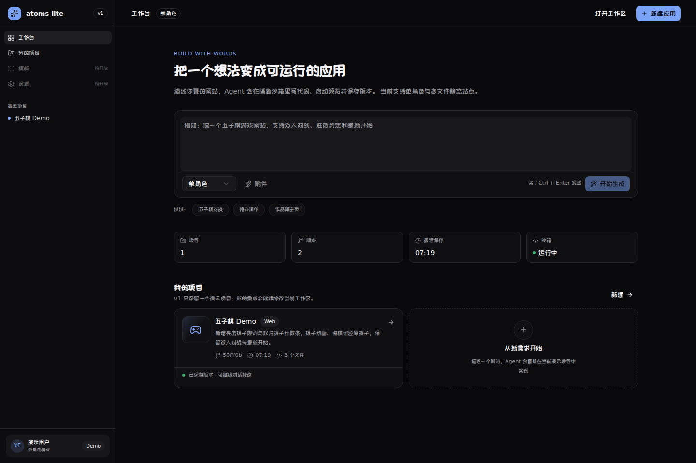
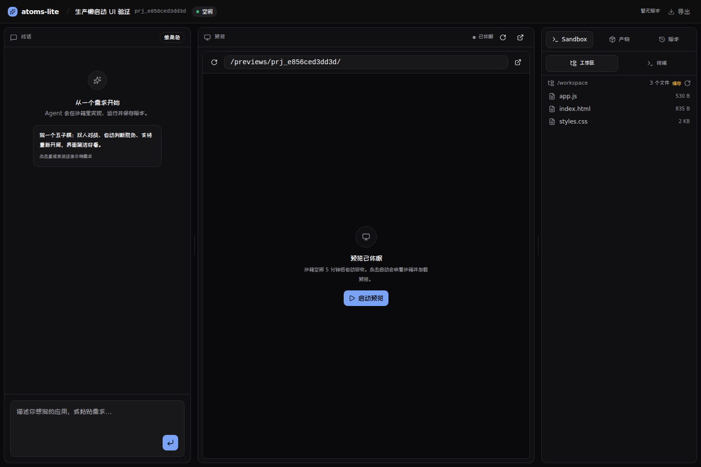
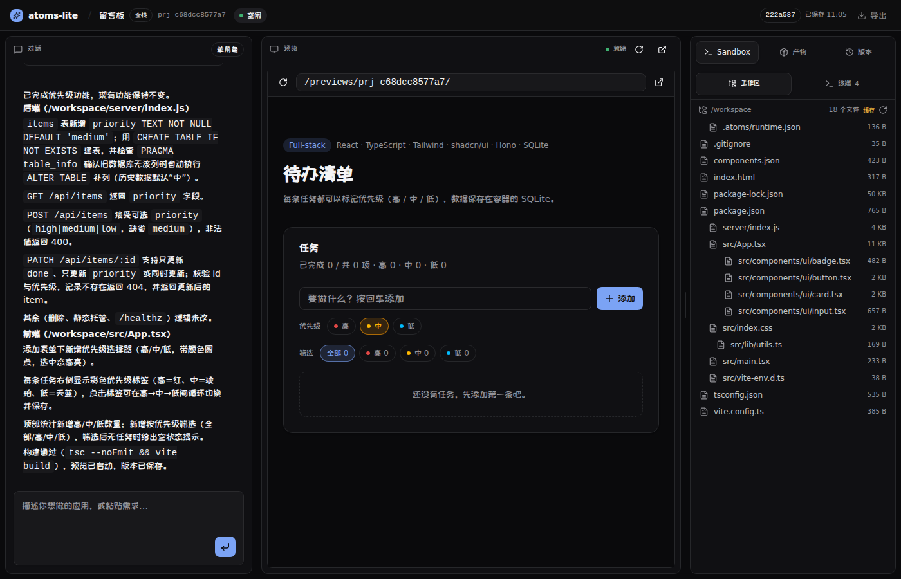
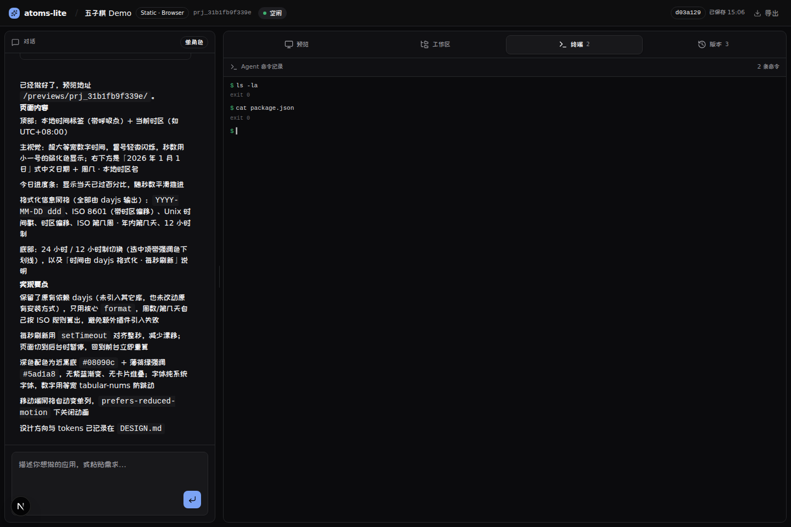
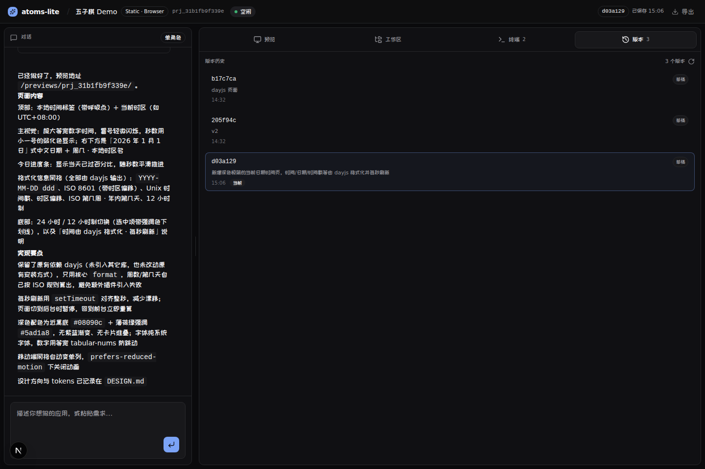
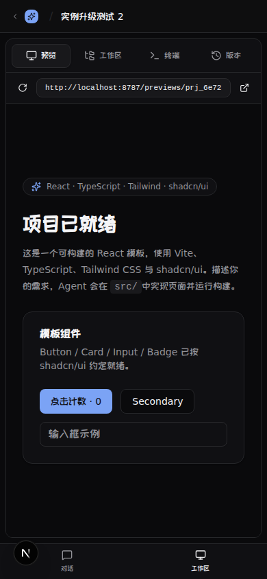

# A/B/C 实现记录（单角色 · 多运行时生成器）

状态：**已实现并部署**（2026-11-19；2026-11-20 文档校对）

## 1. 范围

- 两个页面：**首页工作台** `/` 与**会话工作区** `/sessions/:projectId`
- **多项目**：首页每次提交需求都会创建一个独立项目（独立容器、文件、git、版本、会话）
- 用户输入需求 → ChatAgent 调工具 → WorkspaceDO 写文件 → 启动预览 → 创建版本
- **三种项目模板、两种运行时**：
  - `static` + **browser**：Web 文件存 DO SQLite，平台直接服务，无容器；依赖通过 esm.sh importmap
  - `react-vite` + container：React 19 + TypeScript + Vite 8 + Tailwind CSS v4 + shadcn/ui + HashRouter（`src/pages/Index.tsx`）
  - `fullstack-hono` + container：上面的前端 + Hono + `node:sqlite` 后端
  - 旧静态项目仍使用 container 运行环境（兼容）
- 项目创建时根据需求自动选择模板并持久化
- 目标示例：五子棋（静态）、番茄钟（React）、带优先级的待办（全栈）

A/B 完成三种模板与构建/预览闭环；C 完成智能选型、browser-static 运行时、
依赖安装与开放 egress。首页不再提供手动技术栈下拉；API 仍保留 `preferredTemplate`
参数用于调试/兼容。Next.js 已明确不支持（容器实例与构建时间不匹配）。
D1/R2/真实发布仍留到后续；全栈数据目前存在容器内 SQLite（快照保留）。

## 2. 组成

| 组件 | 位置 |
|---|---|
| ChatAgent | `apps/worker/src/agent.ts`（AIChatAgent + AI SDK tools，每项目 1 个实例） |
| WorkspaceDO | `apps/worker/src/workspace/do.ts`（每项目 1 个：容器/文件/版本/快照） |
| 项目索引 | `apps/worker/src/projects.ts`（`Projects` DO，项目元数据 + 版本摘要） |
| Workspace 客户端 | `apps/worker/src/workspace/client.ts` |
| Worker 路由 | `apps/worker/src/index.ts` |
| 沙箱镜像 | `apps/worker/Dockerfile` + `container/` + `container/templates/*` |
| 运行时 supervisor | `apps/worker/container/boot.sh`（静态 / Node 单服务） |
| Web 首页 | `apps/web/components/dashboard/dashboard.tsx` |
| Web 工作区 | `apps/web/components/workspace/*` + `lib/agent.ts` |

架构与决策见 `docs/architecture/`、`docs/decisions/`。

## 2.1 页面结构

```text
/                     首页工作台（dashboard）
/sessions/:projectId  会话工作区（每个项目一个）
```

- `demo` 是 v1 遗留的五子棋项目；新项目 ID 形如 `prj_<12 位>`。
- Next 静态导出只生成一个会话壳 `/sessions/demo`；Worker 把
  `/sessions/<其它 id>` 复用到这个 shell，前端从 `pathname` 读取项目 ID。
- 本地开发用 Next rewrite（`/sessions/prj_:id → /sessions/demo`）模拟。

**首页 `/`**

- 左侧边栏：品牌、工作台/我的项目/模板/设置、最近项目、当前模式
- Hero：品牌标记 + 原子轨道背景（SVG/CSS，无图片请求；电子沿三条轨道运行）
- 主区：聚焦式需求输入（多行、⌘/Ctrl+Enter；技术栈自动推断，不展示运行环境下拉）
- 示例需求：五子棋 / 待办清单 / 作品集主页
- 我的项目：真实版本数据（commit、summary、文件数、保存时间）+ 打开工作区
- 提交需求 → `POST /api/projects` 创建项目 → 跳转 `/sessions/:id?prompt=...`
- 项目卡直接展示真实版本摘要、commit、保存时间与版本数

**会话工作区 `/sessions/:projectId`**

- 两栏：左侧对话；右侧工作台（窄屏底部「对话 / 工作台」切换）
- 工作台顶部 tab：**预览 / 工作区 / 终端 / 版本**
- **打开项目不启动沙箱**：文件列表读 SQL 缓存，预览只探测状态
- 构建型项目在改完源码后调用 build，构建通过再启动预览
- 预览默认显示「预览已休眠」，点击「启动预览」才恢复容器
- 工具调用卡默认折叠，只显示工具名与状态；点击展开参数与结果
- **工作区**：左侧文件树（目录折叠、文件图标、大小），右侧源码查看器
  （行号 + 语法高亮）；选择文件会读取内容，容器项目读取时会启动沙箱
- **终端**：从消息里的 `exec` / `build` 工具调用还原 `$ 命令`、stdout/stderr 与 exit code
- 对话栏支持拖动调整宽度；双击把手恢复默认值，宽度写入 localStorage
- 站内图标文件：`app/icon.svg`（favicon）、`app/apple-icon.png`、页内 `BrandMark`；
  生成项目的图标库约定见 `docs/decisions/07-generated-project-icons.md`
- Agent 实例名 = 项目 ID，因此对话历史、工具调用、容器、版本都按项目隔离
- 进入时读取 `?prompt=`，待 Agent 连接就绪且当前空闲后自动发送；
  发送前用 `history.replaceState` 清掉 query，刷新不会重复发送
- 顶栏显示项目名与项目 ID，logo 可返回首页

首页与工作区之间没有额外的管理页面；设置、版本、文件都在工作区面板内完成。

## 3. 关键行为

- **模板选型**：先走确定性规则（`templates.ts`）：全栈信号（登录/数据库/API/上传…）
  → fullstack；React/SPA/组件/路由 → react-vite；否则 static。
- **模型 planner**：规则拿不准且没有显式技术栈时，调用一次短模型
  （`planner.ts`，严格枚举，12s 超时，0 重试）选择最小模板；失败回退规则。
  显式技术栈/后端信号、五子棋/个人主页等明确静态需求不调用模型。
- **选型可观测**：项目保存 `templateSource`（rule/model/manual/fallback）与
  `planReason`；项目卡 badge 的 tooltip 显示原因，模型选择的 badge 带 Sparkles。
  首页只走自动选型；`manual` 仅保留在 API 路径，不再有 UI 入口。
- **pending / configured**：自动选型项目创建时 `configured=0`，只保存建议模板；
  第一轮由 `ask_user` 确认需求和技术栈，客户端调用 `/configure` 后才挂载文件/构建工具。
  通过 API 手动指定模板的项目直接 `configured=1`。
- **模板配置**：配置写入 WorkspaceDO 的 `atoms_project_config`，不启动容器；
  首次 `ensure()` 按模板播种。配置后、第一次写入前可以重新配置。
- **前端结构**：`src/App.tsx` 是 HashRouter shell，默认首页在 `src/pages/Index.tsx`；
  新页面放 `src/pages` 并在 App.tsx 注册。HashRouter 避免 `/previews/:id/` 路径冲突。
- **设计流程**：提示词要求先确定视觉方向和布局，再实现；首屏内容初始可见，
  避免默认紫蓝渐变和居中卡片堆叠。当前没有自动生成 `DESIGN.md` 的步骤。
- **预装依赖**：React/全栈模板的 `node_modules` 在镜像构建时 `pnpm install --frozen-lockfile` 安装，
  工作区用软链复用，Agent 不需要也不能执行 pnpm install。
- 镜像内预构建模板的 starter `dist`，新项目首次打开预览即可看到模板；Agent 构建后覆盖。
- **实时连接**：前端 `useAgent` 显式使用 `cf-websocket`（Hibernation API）；
  Agents SDK 默认用 `ctx.acceptWebSocket`，空闲时 DO 可休眠，不持续计 duration。
  未使用 `capnweb` transport，也没有 `agent.stub`/`agent.call`，不会把 DO 钉在内存里。
  ChatAgent 与 WorkspaceDO 是两个 DO；后者只在工具/容器活跃时工作，容器 5 分钟空闲回收。
- **运行时**：`boot.sh` 是 PID 1 supervisor，读取
  `/workspace/.atoms-lite/runtime.json`（旧快照回退 `.atoms/runtime.json`）：
  - `kind: static` → `server.mjs` 服务 `serveDir`（静态站点 / `dist`）
  - `kind: node` → 启动 `startCommand`（Hono，监听 8080）
  - `touch /workspace/.atoms-lite/restart` 让 supervisor 重启子进程
- `.atoms-lite/`（以及兼容旧项目的 `.atoms/`）是平台内部目录：
  不出现在文件树、Agent 工具与预览里，并通过模板 `.gitignore` 排除在版本之外。
- **构建**：`build` 工具读取 `buildCommand`（`pnpm build`），超时 5 分钟，
  日志返回给 Agent；React/全栈模板的 build 包含 `tsc --noEmit`。
  build 与版本/checkout 共用串行队列，避免并发写 `dist`。
- **回滚**：checkout 先删除 `dist` 再构建；构建失败返回 `buildError` 且不重启预览。
- **预览就绪**：`/healthz` 与根页面都返回 200 才算 ready，缺 dist 不再假装就绪。
- **start_preview**：只负责「服务可用 + 让新产物生效」。static / react-vite 构建后由静态 server
  直接读磁盘，刷新 iframe 即可；只有 `kind: node` 的全栈项目才重启长驻进程。
- **全栈数据**：SQLite 存在 `/data/app.db`，不在 `/workspace`，代码回滚不会删数据。
  用户通过预览代理写数据（POST/PATCH/DELETE）后，DO 设置 10s 延迟 alarm，
  触发一次容器快照，避免 5 分钟空闲回收丢数据。
- **文件缓存**：写文件只局部 upsert 该路径；exec/build/版本/seed 才做全量
  `find + wc` 校准，避免每次写文件全扫。
- **快照可见性**：`takeSnapshot()` 返回 `{ok,error}`；创建版本时快照失败会把该版本
  status 标为 `failed`，TopBar 显示「快照失败」，`/meta` 暴露 `snapshotError`。
- **destroy**：清空业务表后立即写回最小默认行（workspace/config/runtime_status），
  同 ID 再次访问不会因 constructor 初始化时机 500。
- 每个项目一个 WorkspaceDO + 一个容器；沙箱空闲 **5 分钟**回收。
- **运行时**：
  - `browser`（新 static 项目）：文件、版本、依赖都在 DO SQLite；预览由 Worker 直接服务；
    不创建容器，不做 5 分钟回收；版本用内容 SHA-256 而不是 git。
  - `container`（React/全栈/旧 static）：容器 + git + 快照。
- **依赖安装**：
  - `install_packages` 工具；browser 运行环境注册 esm.sh URL 并注入 importmap；
    container 运行环境执行 `pnpm add`（registry 使用 npmmirror），项目节点是独立 node_modules。
  - 镜像最终 **不包含 npm/npx**：构建时用 npm 安装 pnpm 后立即删除 npm；
    运行期只有 node + pnpm。
  - 容器 egress 已开放（`enableInternet: true`），可在运行时安装镜像预装之外的包。
  - 浏览器静态项目不支持 TS/JSX/React 编译；HTML 资源必须相对路径。
- **镜像**：改为 `node:24-bookworm-slim`（Debian/glibc），安装 git/procps/pnpm；
  pnpm store 层缓存；依赖安装与构建可复现；最终镜像删除 npm/npx。
- **实例**：自动升级方案见 `docs/decisions/06-instance-auto-upgrade.md`（自动升级未实现，
  手动升级已实现）。Wrangler 配置层不支持 DO 容器的 `instance_type`，但运行期
  `container.start({ instance })` 支持预定义档位。默认 `basic`（1/4 vCPU / 1 GiB / 4 GB），
  可升级 `standard-1`（1/2 vCPU / 4 GiB / 8 GB）→ `standard-2`（1 vCPU / 6 GiB / 12 GB），
  不支持降级；升级前快照、destroy、从快照启动，数据保留。
- **懒启动**：只有真正需要容器时才 `ensure()`：
  - Agent 的 `list_files` / `read_file` / `write_file` / `exec` / `start_preview` / `create_version`
  - 用户点击「启动预览」，或在文件面板点击「同步文件」
  - 打开工作区、首页列表、版本列表、预览状态探测都不会启动
- 文件列表默认读 DO SQL 缓存（`atoms_files`），不读容器：
  - `GET /files`：返回缓存 + `running` + `cachedAt`
  - `POST /files/refresh`：启动/恢复容器后重新执行 `find` 并更新缓存
  - Agent 的 `list_files` 走 `/tools/list`，需要真实工作区，会启动容器
  - 缓存写入时机：冷启动 seed、write_file、exec、createVersion、checkout
- 预览只有显式操作或生成工具结果才加载 iframe；ready 后停止轮询，
  避免打开页面时持续刷新容器活跃时间。
- 手动刷新在预览已就绪时只重载 iframe（URL 带 cache-buster），不重启服务；
  服务重启会等待旧进程 down、新进程 ready，避免 iframe 读到旧进程的响应。
- 版本创建与 `finish` 时自动快照，重启时从该项目的快照恢复。
- 项目索引 `Projects` DO：保存
  `id/name/prompt/template/runtime/template_source/plan_reason/configured/created_at/updated_at`；
  读取时并发向各 WorkspaceDO 的 `/meta` 补齐版本数与当前版本（不启动容器）。
- **运行环境切换**：`switch_runtime` 只允许单向升级（browser < container/basic < standard-1 < standard-2）。
  旧文件导出到 `atoms_migration_files`，目标工作区解压到 `_sandbox_migration/`；
  模型通过 `list/read/copy/finish_migration` 选择性迁移。该目录从 git、文件树、预览和版本排除。
- **Agent 上下文**：每轮把运行环境/time/capabilities 等附加到最后一条用户消息的模型副本，
  不写回消息存储；工具按 `RuntimeContext` 条件动态挂载。
- **ask_user**：15 分钟线性倒计时卡片；提交后客户端配置项目并 `addToolOutput` 续跑。
- **subagent**：只读的 `subagent` + `code_review` / `design_review`，每次最多 2 次。
- 预览通过 Worker 代理 `/previews/:projectId/*`；容器内的服务只支持 HTTP，代理时把 scheme 改成 `http:`。
- **预览元素选择**：同源 iframe 内高亮元素，收集 selector/outerHTML/关键样式，
  作为请求 body 的选择上下文发给 Agent；不写入消息历史。本地跨端口开发不可用，生产同源可用。
- **设计审查**：`/design-review` 命令或 `design_review` 工具触发；先跑 Impeccable WASM detector 源码扫描，
  再交给只读设计子 agent。预览只保留元素选择，不再放设计检查按钮。
- **对话命令**：输入框提供 `/design-review`、`/code-review`、`/polish` 命令，映射为对应的 Agent 指令；
  输入 `/` 直接弹出命令菜单，支持方向键选择、Enter/Tab 插入命令名、Esc 关闭；
  选中后可继续补充要求，再按回车执行。
- **步数上限确认**：达到单轮工具步数上限时，`prepareStep` 强制模型调用 `confirm_continue`，
  聊天中显示「继续执行 / 结束本轮」卡片；确认后通过 client tool output 续跑，
  不再需要用户手打「继续」。只有上一轮仍有工具调用时才触发。
- **聊天时间**：持久化消息写入 `metadata.createdAt`；相邻消息间隔 ≥5 分钟时显示时间分隔，
  今天只显示 `HH:mm`，昨天显示「昨天 HH:mm」，更早显示日期 + 时间。
- **ask_user 历史**：已完成的 ask_user 卡片在会话历史里展示当时的问题和答案，
  刷新或重新进入项目仍可见。
- **结构化日志**：`[agent.turn.start/finish/abort/error]` 包含
  `projectId`、`requestId`、`continuation`、模板/运行环境、steps、finishReason、
  token 用量和耗时，便于按项目/回合过滤；流中断恢复使用
  `chatStreamStallTimeoutMs` + `chatRecovery.terminalMessage`。
- **首页精简**：移除角色/技术栈下拉、统计卡和底部「新建项目」卡；技术栈由需求自动推断。
- **回滚**：先自动保存未提交改动，再用 `git read-tree` 恢复目标树并生成新的 rollback commit/version；
  checkout 后校验 Git HEAD 与 currentVersion，避免快照与版本指针不一致。
- **预览地址栏**：输入新 URL 会更新 iframe 的 src，不再只是修改地址栏状态。
- **预览重启**：超时明确失败，不再接受旧进程的 healthy 响应；旧快照没有 preview supervisor 时
  降级为 `ensurePreview()`，避免重启信号永远无人消费导致 60 秒超时。
- 预览状态由 `GET /api/projects/:id/preview/status` 探测（`running` / `ready`）；
  只在启动/加载阶段短轮询，就绪后停止。
- 版本 = git commit（browser 项目为内容哈希）+ `atoms_versions` 行；版本列表在容器停止时仍可读。
- 写文件走 `Files`（需要镜像内的 `sandbox-shim`）；命令走 `exec`（程序白名单）。
- 前端同源访问；本地开发用 `NEXT_PUBLIC_WORKER_HOST=http://localhost:8787`。
- 项目 API：`/api/projects`（列表/创建）、`/api/projects/:id`
  （详情 / PATCH 重命名 / DELETE 删除）、`/api/projects/:id/{versions,files,preview/*}`；
  预览 `/previews/:id/*`。
- 删除项目会删除索引行，并尽力销毁对应 WorkspaceDO（容器 + DO 存储）
  与 ChatAgent 的会话存储。
- 旧的 `/api/workspace/*` 仍映射到 `demo`，仅作兼容/调试。

## 4. 验证记录

### 本地

- 静态模板：容器启动 ~1s；3 个文件；预览 200。
- 真实模型生成：**约 90 秒**完成 `list_files → write_file × 3 → exec → start_preview → create_version`。
- 预览标题 `五子棋 · Gomoku`；点击棋盘后「已落子 1 手」「轮到白棋」；localStorage 写入；无 console 错误。

### 生产（https://atoms-lite.fengyj.me）


- 静态资源 200；`/health` 200；容器冷启动 ~8s。
- 真实 UI 输入 → 版本创建 → 预览可玩；生成约 3 分钟。
- 预览 200，文件列表 3 个，版本列表 1 条（commit `1d6d331`）。
- 点击棋盘点位后手数增加、执子方切换。
- **空闲回收恢复**：停止请求 400s 后 `preview/status` 为 `{running:false}`；再请求 `/previews/demo/` 返回 200、标题仍为「五子棋 · Gomoku」，3 个文件大小不变，版本仍为 `1d6d331`。
- **预览状态探测**：容器运行且服务就绪时徽标为「就绪」；休眠时显示「已休眠」。

### 实例升级（本地/生产实测）

- 新项目默认 `basic`；`POST /api/projects/:id/instance/upgrade`：
  basic → standard-1 → standard-2，第三次返回 `max:true`。
- 升级前自动快照，destroy 后用新实例从快照启动；文件 marker 和预览均保留。
- 生产验证：basic → standard-1（13s）→ standard-2，数据保留；browser runtime 返回
  “does not use a container”，不报 500。

### browser-static（本地实测）

- 新建 static 项目：`runtime=browser`，`preview/status={running:false,ready:true}`，
  打开预览不启动容器。
- 文件：模板 3 个文件写入 DO SQLite；`list_files/read_file/write_file` 正常。
- 依赖：`install_packages ["dayjs@1.11.13"]` 注册 `https://esm.sh/dayjs@1.11.13`，
  预览 HTML 注入 importmap；页面 `import dayjs from "dayjs"` 正常显示日期时间。
- 版本：内容 SHA-256；创建两个版本后 checkout v1，文件内容恢复。
- Agent 生成「当前日期时间页」：版本 3，预览显示真实时间，无 console 错误。
- 注意：HTML 资源必须相对路径；绝对 `/app.js` 在 `/previews/:id/` 下会 404。

### 容器依赖安装（本地实测）

- `install_packages ["dayjs@1.11.13"]` 执行 `pnpm add`，exitCode 0，
  `package.json` 包含 dayjs；registry 使用 npmmirror。
- 生产/本地构建均使用 pnpm；容器 egress 已打开。

### 智能选型（本地实测）

- 显式 `用 React…`：0.13s，`template=react-vite`，`source=rule`
- 手动指定 Static + React 需求：`template=static`，`source=manual`
- 模糊需求「团队任务看板，支持拖拽卡片和状态流转」：
  4.3s，`template=react-vite`，`source=model`，
  原因「看板需组件化与拖拽状态管理，纯前端无后端需求，选 react-vite。」
- 显式「带数据库的前后端」：`template=fullstack-hono`，`source=rule`

### 模板与构建（本地/生产实测）

- 选型：`做一个五子棋` → `static`；`用 React 做组件化待办` → `react-vite`；
  `带数据库的前后端` → `fullstack-hono`。
- React：镜像内 `tsc --noEmit && vite build` 通过（约 4–5 秒），
  `dist/` 由静态服务器提供；`base: "./"` 保证在 `/previews/:id/` 下资源可用。
- React Agent 生成：番茄钟（TSX + Tailwind + shadcn），版本 1 条，
  预览 iframe 正常渲染，开始/暂停/重置可操作。
- 全栈：构建约 4–22 秒；Hono 服务 `/healthz` 与 `/api/items`；
  前端在预览路径下用相对 `./api/…` 调用，新增任务、刷新后仍在。
- 全栈 Agent 生成：给任务增加高/中/低优先级，SQLite 增加 `priority`、
  旧表自动迁移，API 与前端标签/筛选更新，版本创建成功。
- 生产同一套模板也通过：React 模板渲染、全栈 SSR 静态页 + API 写入成功。
- 新镜像内已预构建 starter `dist`：未运行 build 也能先看到模板页面（隔离容器实测）。
- **全栈数据持久化**：生产环境写入任务后 10s 触发快照；容器空闲回收
  （`running:false`）再启动预览，任务仍在（`快照持久化验证2`）。
- 旧快照兼容：容器 entrypoint 内联判断 `/opt/preview/boot.sh`，
  旧快照没有该文件时回退到静态 `server.mjs`。

### 懒启动（本地实测）

- 新建项目：`preview/status` 为 `{running:false}`；`GET /files` 返回
  `{ entries: [], running: false, cachedAt: 0 }`；`GET /versions`、`GET /api/projects`
  之后状态仍为 `running:false`。
- 打开 `/sessions/<id>`：无预览 iframe，显示「预览已休眠」+「启动预览」；
  容器仍未启动。
- 点击「启动预览」：容器启动，iframe 加载，文件缓存写入 3 个模板文件。
- 首页创建需求后：Agent 首次 `list_files`（`/tools/list`）启动容器，
  生成完成、版本创建、预览自动切换到「就绪」。
- 工作区不再定时探测预览，因此页面开着也不会持续保活；容器按空闲 5 分钟回收。

生产同样验证：

- 新建项目打开 `/sessions/<id>`：`preview/status` 为 `{running:false, ready:false}`，
  没有预览 iframe，显示「预览已休眠」。
- 点击「同步文件」：返回 3 个模板文件，容器 `running:true`。
- 点击「启动预览」：`ready:true`，iframe 加载 `/previews/<id>/`。
- 首页/项目列表/版本列表不会启动容器。
- 部署后对已有项目执行一次 `POST /files/refresh` 预热文件缓存，之后打开只读缓存。
- **空闲后打开已验证**：等待容器回收后，`preview/status` 为 `{running:false}`；
  打开项目后仍为 `running:false`，文件树显示缓存中的 `app.js/index.html/styles.css`，
  预览为「已休眠」，没有创建 iframe。

### 多项目隔离（生产）

- 首页创建「待办清单」项目 → `prj_3e5dee2fc07e`，整页进入 `/sessions/prj_3e5dee2fc07e`。
- 工作区标题 `待办清单 · atoms-lite`，预览地址 `/previews/prj_3e5dee2fc07e/`。
- 约 3 分钟生成完成，新项目版本 1 条（`0fed082`），预览标题「待办清单」。
- 同时检查五子棋项目：仍为 **2 个版本**（`50fff0b`），预览标题仍是「五子棋 · Gomoku」。
- 首页同时显示两个项目；项目卡显示各自的版本摘要。
- 无 console / page 错误。

### 交互细节（生产）

- **工具卡默认折叠**：历史消息中的 `data-tool` 全部为 `closed`；点击标题可展开。
- **工作台 tabs**：预览 / 工作区 / 终端 / 版本；工作区文件树可选择文件并在右侧查看行号+高亮源码。
- **终端**：五子棋项目显示 24 条命令（`$ node --check app.js`、`$ grep …` 及 exit code）。
- **拖动调整宽度**：对话栏 384 → 464px；刷新后仍为 464（localStorage 记忆）。
- **重命名**：首页项目卡菜单 → 重命名 → 保存，列表立即显示新名称。
- **删除**：首页项目卡菜单 → 删除 → 二次确认；卡片消失，`GET /api/projects/:id` 返回 404。

### 首页 → 工作区闭环



- `/` 200，标题正确；项目卡显示真实 commit、summary、文件数与保存时间。
- 点击项目卡 → `/sessions/demo` 200，工作台正常加载。
- 在首页输入修改需求并点「开始生成」：
  - 跳转 `/sessions/demo?prompt=...`，随后 query 被清空；
  - Agent 连接就绪后自动发送，对话中可见该需求；
  - 约 3 分钟后生成完成，新版本 `50fff0b`，summary 为提子计数条改动；
  - 首页刷新后显示新版本；预览出现「黑棋提子 / 白棋提子」计数条；
  - 点击棋盘仍可正常落子（`已落子 1 手`、`轮到白棋落子`），无 console 错误。

## 4.1 代码审查

A/B 模板与运行时审查见 `docs/reviews/ab-review.md`。


详见 `docs/reviews/v1-code-review.md`。P0（快照/seed 覆盖）与关键 P1（ensure 覆盖、healthz、checkout、幂等、超时、白名单、Origin）已修复并通过生产回归；审批接线、预览错误态等列为后续。

## 4.2 页面截图

| 首页（多项目） | 工作区（待办清单） |
|---|---|
|  |  |

打开已有项目时，预览默认不启动容器：


空闲回收后打开项目：文件来自缓存，容器仍处于休眠：



React（番茄钟）与全栈（优先级待办）生成结果：

| React | 全栈 |
|---|---|
|  |  |

工作台「工作区」tab：左侧文件树，右侧源码查看器。


工作台「终端」与「版本」tab：





移动端：底部「对话 / 工作台」，工作台内部 tab 保留。



五子棋工作区见 `assets/v1-workspace.png`。

## 5. 已知限制

- 没有访问控制；公网 URL 可被任意人使用（演示期接受，需加预算上限）。
- 每个项目固定一个会话。
- 工作台终端是只读的命令记录，不是可交互 shell；命令仍需通过对话让 Agent 执行。
- 重命名/删除入口在首页项目卡；工作区内暂未放项目菜单。
- 依赖可通过 `install_packages` 安装；browser 运行环境走 esm.sh，container 运行环境走 pnpm + egress。
- 镜像运行期只有 pnpm；旧快照如果只有 npm，安装新包不兼容（旧项目可删除）。
- Next.js **不支持**；即使可升级到 standard-2，Next 的镜像、构建和运行成本仍不匹配当前架构。
- 旧项目（旧 Alpine/npm 快照）仍可预览/构建，但安装新包需要新建项目。
- 浏览器静态运行时的预览与主站同源，生成代码仍应视为不可信；没有容器级 CPU/内存隔离。
- 容器 egress 已开放，生成代码可以访问互联网；演示环境需注意滥用和供应链风险。
- 全栈数据靠容器快照保留（写入后 10 秒内快照）；不是真正的外部数据库，
  多实例/长期持久化应换 D1。快照失败会标记版本/顶栏，但不自动重试。
- 平台对话附件未实现（无 UI、无 R2）；生成应用内部的用户上传由生成应用写入容器，
  随快照保留，不经过平台 R2。D1/R2 是规模化后的存储层。
- **安全边界**：演示版无鉴权，预览 iframe 与主站同源（`allow-same-origin`），
  生成代码必须视为不可信；生产化需要独立预览域 + 访问门禁。
  当前已在 Worker 层拦截 `/previews/:id/.git/*`，并限制 Agent 的 exec 白名单。
- 项目索引在 `Projects` DO 中，尚未迁移到 D1；项目多时首页需要 N 次 DO 读取。
- 每个活跃项目都会占一个容器；并发项目多时受 Cloudflare 容器配额限制。
- Workspace 是 Durable Object；容器通过 `scheduling_policy: durable_object` 绑定到 DO。
  实例默认 `basic`（1/4 vCPU / 1 GiB / 4 GB），可在运行期升级到 standard-1/standard-2；
  升级不可降级。更重的 React/Next 项目仍建议构建服务。
- 导出未实现（入口已移除）；产物 tab 空态；回滚后端已支持非破坏性 checkout，但没有 UI。
- 模板依赖为镜像预装；新增依赖可通过 `install_packages` 安装（browser 走 esm.sh，container 走 pnpm）。
- ChatAgent 的 `create_version` 可能被模型调用两次；已做幂等，不会插重复版本。
- 预览的 HMR 未验证（静态站点不需要）。

## 6. 本地运行

```bash
pnpm install
cp apps/worker/.dev.vars.example apps/worker/.dev.vars  # 填 MODEL_*
pnpm dev:worker   # :8787
pnpm dev:web      # :3000（需 NEXT_PUBLIC_WORKER_HOST=http://localhost:8787）
```

## 7. 生产部署

```bash
NEXT_PUBLIC_WORKER_HOST= pnpm --filter @atoms-lite/web build
cd apps/worker
wrangler secret put MODEL_API_KEY -c wrangler.prod.jsonc
wrangler deploy -c wrangler.prod.jsonc
```

域名：`atoms-lite.fengyj.me`（Custom Domain）。
